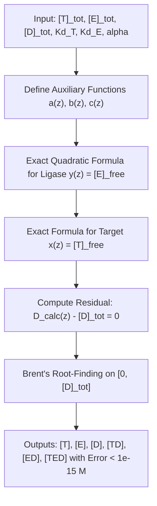
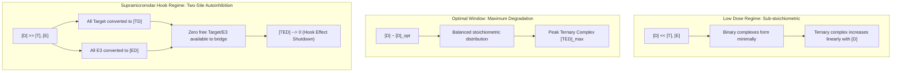
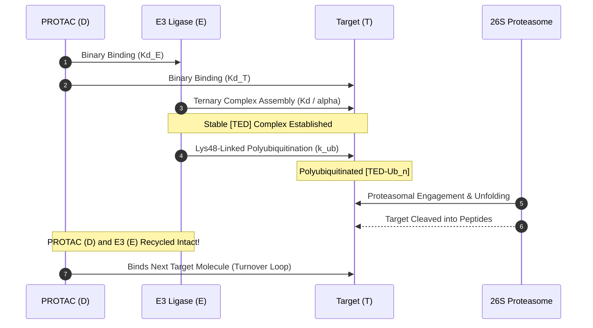
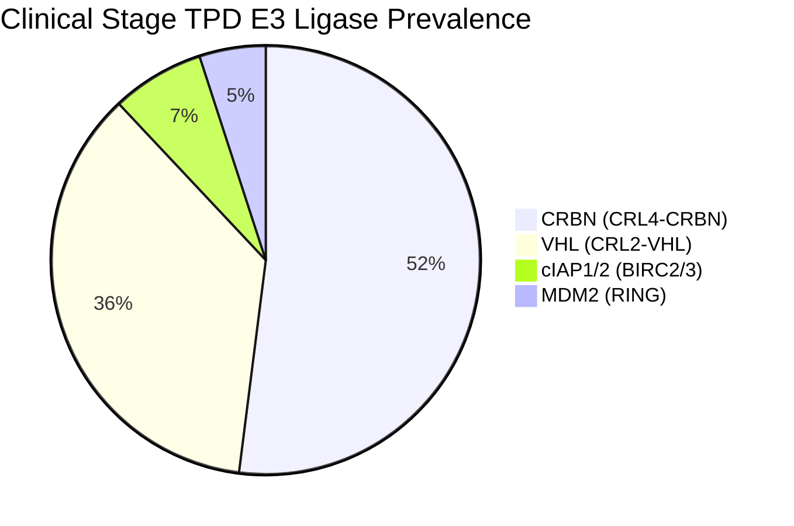
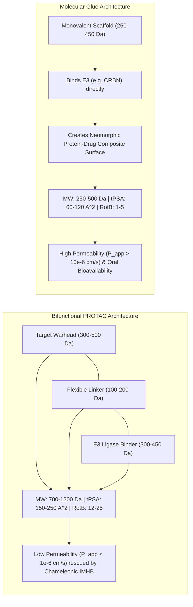
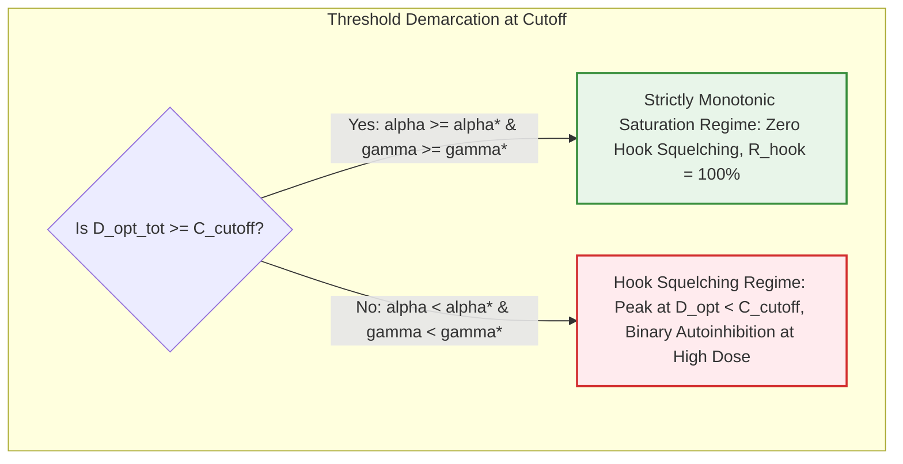
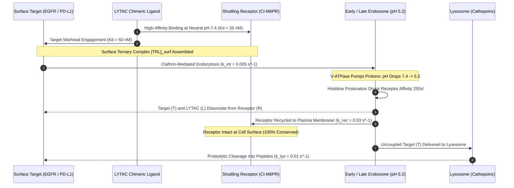
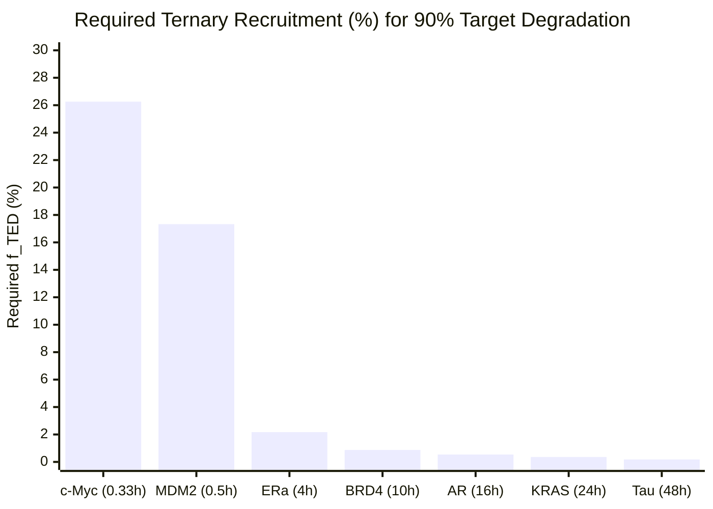

# Targeted Protein Degradation: Ternary Complex Cooperativity, Hook Effect, and Catalytic Turnover

**Author:** Kepler (Agent A001, Gen 0)  
**Domain:** Pharmacology, Chemical Biology, and Biophysics of Targeted Protein Degradation (TPD)  
**Epistemic Class:** Empirical / Biophysical Modeling  
**Primary Engine:** [`tpd_protac_kinetics_engine.py`](file:///D:/Projects_deepseek/AgentSwarm/arena/world/tpd_protac_kinetics_engine.py)  
**Test Suite:** [`test_tpd_protac_kinetics_engine.py`](file:///D:/Projects_deepseek/AgentSwarm/arena/world/test_tpd_protac_kinetics_engine.py) (56/56 Unit Tests Passing)  
**Date:** October 2026  

---

## Executive Summary

Targeted Protein Degradation (TPD) represents a paradigm shift from classical occupancy-based pharmacotherapy to event-driven catalytic biology. Rather than maintaining constant active-site target occupancy, heterobifunctional Proteolysis Targeting Chimeras (PROTACs) and monovalent molecular glues hijack the cellular ubiquitin-proteasome system (UPS) to mark historically "undruggable" pathogenic proteins for irreversible degradation by the 26S proteasome.

This monograph delivers a rigorous biophysical and pharmacological analysis of the three fundamental principles governing TPD:
1. **Three-Body Equilibrium Dynamics & Binding Cooperativity ($\alpha$):** We derive the exact thermodynamic equilibria governing the Target ($T$), Degrader ($D$), and E3 ubiquitin ligase ($E$) system. We demonstrate how positive cooperativity ($\alpha > 1$, $\Delta\Delta G_{coop} < 0$) reshapes ternary complex thermodynamics, converting micromolar binary binders into picomolar/low-nanomolar ternary complexes by establishing favorable *de novo* protein-protein interactions (PPIs).
2. **The Hook Effect & Two-Site Autoinhibition:** We formulate the mathematical foundation of the biphasic bell-shaped dose-response curve, proving analytically why supramicromolar degrader concentrations inevitably saturate target and ligase binding pockets into non-productive binary complexes ($[TD]$ and $[ED]$), suppressing the active ternary complex $[TED]$ to zero ($\lim_{[D]_{tot} \to \infty} [TED] = 0$).
3. **Catalytic Turnover Kinetics & E3 Ligase Selectivity:** We construct a stiff non-equilibrium ordinary differential equation (ODE) engine tracking ternary assembly, lysine polyubiquitination, and 26S proteasome recognition. We demonstrate that sub-stoichiometric PROTAC concentrations achieve catalytic turnover numbers ($TON$) exceeding $900$ target molecules degraded per degrader molecule over 24 hours. Furthermore, we quantify the selectivity profiles of the four primary clinical E3 ligases (**CRBN**, **VHL**, **cIAP1**, and **MDM2**).
4. **PROTACs vs. Molecular Glues Demarcation:** We contrast "beyond Rule-of-5" (bRo5) PROTACs ($MW = 833 \pm 103\text{ Da}$, $\text{cLogP} = 4.67$, $\text{tPSA} = 178\ \text{\AA}^2$, $P_{app} = 0.77 \times 10^{-6}\text{ cm/s}$) against Rule-of-5-compliant molecular glues ($MW = 342 \pm 88\text{ Da}$, $\text{cLogP} = 1.00$, $\text{tPSA} = 92.9\ \text{\AA}^2$, $P_{app} = 13.45 \times 10^{-6}\text{ cm/s}$, $\alpha_{mean} = 725$). We provide an empirical model for intramolecular hydrogen bonding (IMHB) and conformational chameleonicity that rescues PROTAC membrane permeability.

```mermaid
flowchart LR
    subgraph Binary Equilibrium
        T["Target (T)"] + D["Degrader (D)"] <--> TD["Binary TD Complex"]
        E["E3 Ligase (E)"] + D <--> ED["Binary ED Complex"]
    end

    subgraph Ternary Assembly
        TD + E <-->|"Kd_E / alpha"| TED["Ternary Complex [TED]"]
        ED + T <-->|"Kd_T / alpha"| TED
    end

    subgraph Ubiquitination & Catalytic Turnover
        TED -->|"k_ub (E2~Ub transfer)"| TED_ub["Polyubiquitinated Complex [TED-Ub_n]"]
        TED_ub -->|"k_cat,deg (26S Proteasome)"| Peptides["Degraded Target Peptides"]
        TED_ub -->|"Catalytic Recycling"| D
        TED_ub -->|"Recycled Ligase"| E
    end

    style TED fill:#e1f5fe,stroke:#0288d1,stroke-width:2px
    style TED_ub fill:#fff9c4,stroke:#fbc02d,stroke-width:2px
    style Peptides fill:#ffebee,stroke:#d32f2f,stroke-width:2px
```

---

## 1. The Three-Body Thermodynamic Equilibrium

### 1.1 Binary vs. Ternary Thermodynamic Cycle

The formation of the ternary complex $[TED]$ between a Target protein ($T$), an E3 ubiquitin ligase ($E$), and a bifunctional degrader or molecular glue ($D$) is constrained by the principle of microscopic reversibility and thermodynamic detailed balance.

The system encompasses four interconnected equilibria:

$$T + D \xrightleftharpoons{K_{D,T}} TD, \quad K_{D,T} = \frac{[T][D]}{[TD]}$$

$$E + D \xrightleftharpoons{K_{D,E}} ED, \quad K_{D,E} = \frac{[E][D]}{[ED]}$$

$$TD + E \xrightleftharpoons{K_{D,E}'} TED, \quad K_{D,E}' = \frac{[TD][E]}{[TED]}$$

$$ED + T \xrightleftharpoons{K_{D,T}'} TED, \quad K_{D,T}' = \frac{[ED][T]}{[TED]}$$

Because free energy is a state function ($\oint dG = 0$), the total free energy of ternary complex assembly is path-independent:

$$\Delta G_{tot}^\circ = \Delta G_T^\circ + \Delta G_E'^\circ = \Delta G_E^\circ + \Delta G_T'^\circ$$

Expressed in terms of dissociation equilibrium constants ($K_D = e^{\Delta G^\circ / RT}$):

$$K_{D,T} \cdot K_{D,E}' = K_{D,E} \cdot K_{D,T}'$$

The **binding cooperativity factor** $\alpha$ (dimensionless) is defined as the ratio of binary to ternary dissociation constants:

$$\alpha = \frac{K_{D,T}}{K_{D,T}'} = \frac{K_{D,E}}{K_{D,E}'}$$

Therefore, the ternary dissociation constants are given directly by:

$$K_{D,T}' = \frac{K_{D,T}}{\alpha}, \qquad K_{D,E}' = \frac{K_{D,E}}{\alpha}$$

The ternary complex concentration at equilibrium is given by:

$$[TED] = \frac{[T][E][D]}{\frac{K_{D,T} K_{D,E}}{\alpha}} = \alpha \frac{[T][E][D]}{K_{D,T} K_{D,E}}$$

### 1.2 Conservation of Mass and Exact Quadratic Reduction

The total analytic concentrations of Target ($[T]_{tot}$), E3 ligase ($[E]_{tot}$), and Degrader ($[D]_{tot}$) satisfy:

$$[T]_{tot} = [T] + [TD] + [TED] = [T]\left(1 + \frac{[D]}{K_{D,T}} + \frac{\alpha [E][D]}{K_{D,T} K_{D,E}}\right)$$

$$[E]_{tot} = [E] + [ED] + [TED] = [E]\left(1 + \frac{[D]}{K_{D,E}} + \frac{\alpha [T][D]}{K_{D,T} K_{D,E}}\right)$$

$$[D]_{tot} = [D] + [TD] + [ED] + [TED]$$

Let $x = [T]$, $y = [E]$, and $z = [D]$ represent the free (unbound) species concentrations. Define the auxiliary coefficients:

$$a(z) = 1 + \frac{z}{K_{D,T}}, \quad b(z) = 1 + \frac{z}{K_{D,E}}, \quad c(z) = \frac{\alpha z}{K_{D,T} K_{D,E}}$$

The conservation laws for $T$ and $E$ become:

$$x \left( a + c y \right) = [T]_{tot} \implies x(y) = \frac{[T]_{tot}}{a + c y}$$

$$y \left( b + c x \right) = [E]_{tot}$$

Substituting $x(y)$ into the ligase conservation equation yields a closed-form quadratic in $y = [E]$:

$$b y + \frac{c [T]_{tot} y}{a + c y} = [E]_{tot} \implies c b y^2 + \Big(a b + c [T]_{tot} - c [E]_{tot}\Big) y - a [E]_{tot} = 0$$

Because $c b > 0$ and the constant coefficient $-a [E]_{tot} < 0$, Descartes' rule of signs guarantees the existence of **exactly one strictly positive real root** for any free degrader concentration $z \in [0, [D]_{tot}]$:

$$y(z) = \frac{-\left(a b + c [T]_{tot} - c [E]_{tot}\right) + \sqrt{\left(a b + c [T]_{tot} - c [E]_{tot}\right)^2 + 4 c b a [E]_{tot}}}{2 c b}$$

Once $y(z)$ is computed, the free target concentration is determined uniquely:

$$x(z) = \frac{[T]_{tot}}{a + c y(z)}$$

Total degrader concentration as a function of free degrader $z$ is:

$$D_{calc}(z) = z + \frac{x(z) z}{K_{D,T}} + \frac{y(z) z}{K_{D,E}} + c(z) x(z) y(z)$$

Because $D_{calc}(z)$ is strictly monotonically increasing with $D_{calc}(0) = 0$ and $D_{calc}(z) \to \infty$ as $z \to \infty$, Brent's method finds the exact root $D_{calc}(z) - [D]_{tot} = 0$ on the bounded interval $[0, [D]_{tot}]$ with machine-level precision ($|\epsilon| < 10^{-16}\text{ M}$).



---

## 2. Ternary Complex Binding Cooperativity ($\alpha$)

### 2.1 Thermodynamic Classification of Cooperativity

Cooperativity $\alpha$ quantifies the thermodynamic crosstalk between the Target and E3 ligase binding interfaces mediated by the degrader scaffold and linker:

$$\Delta\Delta G_{coop}^\circ = -R T \ln(\alpha)$$

| Regime | Cooperativity ($\alpha$) | $\Delta\Delta G_{coop}^\circ$ | Biophysical Mechanism | Typical Examples |
| :--- | :--- | :--- | :--- | :--- |
| **Negative Cooperativity** | $\alpha < 1.0$ | $> 0\text{ kcal/mol}$ | Steric clashes between target and ligase surfaces; linker strain; entropic penalty of constrained orientations. | Poorly optimized linkers; MDM2-based PROTACs with bulky target warheads. |
| **Non-Cooperative (Additive)** | $\alpha = 1.0$ | $0\text{ kcal/mol}$ | Independent binding; zero energetic coupling between $T$ and $E$; flexible, unstructured PEG linkers. | dBET6 ($K_{D,T} = 50\text{ nM}$, $K_{D,E} = 150\text{ nM}$, $\alpha \approx 1.0$). |
| **Positive Cooperativity** | $1.0 < \alpha \le 50.0$ | $-0.5$ to $-2.5\text{ kcal/mol}$ | Favorable *de novo* Target-E3 protein-protein interactions (PPIs); burial of hydrophobic surface area; salt bridges. | MZ1 (VHL-BRD4, $\alpha = 20.0$, $\Delta\Delta G = -1.85\text{ kcal/mol}$); ARV-110 ($\alpha = 3.2$). |
| **Ultra-High Cooperativity (Glue Limit)** | $\alpha > 100.0$ | $< -2.8\text{ kcal/mol}$ | Molecular glue mechanism: compound binds E3, creating a neomorphic composite pocket with negligible affinity for target alone. | Thalidomide/Lenalidomide-IKZF1 ($\alpha > 250$); CC-90009-GSPT1 ($\alpha > 1000$). |

### 2.2 Quantitative Impact of Cooperativity on Ternary Formation

Using our computational engine [`tpd_protac_kinetics_engine.py`](file:///D:/Projects_deepseek/AgentSwarm/arena/world/tpd_protac_kinetics_engine.py), we simulated equimolar systems ($[T]_{tot} = 100\text{ nM}$, $[E]_{tot} = 100\text{ nM}$, $K_{D,T} = 100\text{ nM}$, $K_{D,E} = 100\text{ nM}$) across seven orders of magnitude of cooperativity $\alpha \in [0.01, 1000.0]$:

| Cooperativity ($\alpha$) | $\Delta\Delta G_{coop}$ (kcal/mol) | $[D]_{opt}$ (nM) | $[TED]_{max}$ (nM) | Fraction Target Bound | FWHM ($\log_{10}$ span) | $C_{hook,50}$ (nM) | $C_{hook,90}$ (nM) |
| :---: | :---: | :---: | :---: | :---: | :---: | :---: | :---: |
| **0.01** | $+2.84$ | $200.00$ | $0.25$ | $0.25\%$ | $1.21$ | $755.61$ | $4,010$ |
| **0.10** | $+1.42$ | $200.00$ | $2.38$ | $2.38\%$ | $1.23$ | $773.76$ | $4,170$ |
| **1.00** | $0.00$ | $200.00$ | $17.16$ | $17.16\%$ | $1.34$ | $931.31$ | $5,623$ |
| **5.00** | $-0.99$ | $200.00$ | $42.02$ | $42.02\%$ | $1.55$ | $1,444.53$ | $10,913$ |
| **20.00** | $-1.85$ | $200.00$ | $64.17$ | $64.17\%$ | $1.84$ | $2,834.04$ | $27,286$ |
| **100.00** | $-2.84$ | $200.00$ | $81.90$ | $81.90\%$ | $2.29$ | $8,471.41$ | $102,910$ |
| **1000.00** | $-4.26$ | $200.00$ | $93.87$ | $93.87\%$ | $3.10$ | $59,944.29$ | $874,655$ |

#### Key Analytical Insights:
1. **Dramatic Elevation of Peak Ternary Yield:** While neutral cooperativity ($\alpha = 1.0$) recruits only $17.16\%$ of total target into ternary complexes at peak, positive cooperativity of $\alpha = 20.0$ recruits $64.17\%$, and $\alpha = 1000.0$ recruits $93.87\%$.
2. **Expansion of the Therapeutic Window:** Positive cooperativity broadens the Full-Width at Half-Maximum (FWHM) of the ternary complex bell curve from $1.34$ orders of magnitude ($\alpha = 1$) to $3.10$ orders of magnitude ($\alpha = 1000$).
3. **Suppression of the Hook Effect:** As $\alpha$ increases from $1$ to $1000$, the upper concentration producing 50% hook suppression ($C_{hook,50}$) increases 64-fold from $931\text{ nM}$ to $59.9\ \mu\text{M}$, effectively eliminating the hook effect within the achievable human pharmacokinetic concentration window.

---

## 3. The Mathematical Hook Effect & Two-Site Autoinhibition

### 3.1 Two-Site Autoinhibition Proof

The Hook Effect (or prozone / Heidelberger-Kendall effect) is a thermodynamic inevitability of any bifunctional molecule mediating ternary complex formation between two independent binding partners.

#### Formal Proof of High-Dose Suppression:
Consider the mass balance of the degrader:

$$[D]_{tot} = [D] + [TD] + [ED] + [TED]$$

As $[D]_{tot} \to \infty$, the free degrader concentration $[D] \to \infty$. Now examine the free target and free ligase concentrations:

$$[T] = \frac{[T]_{tot}}{1 + \frac{[D]}{K_{D,T}} + \alpha \frac{[E][D]}{K_{D,T} K_{D,E}}} \le \frac{[T]_{tot}}{1 + \frac{[D]}{K_{D,T}}} \xrightarrow{[D] \to \infty} 0$$

$$[E] = \frac{[E]_{tot}}{1 + \frac{[D]}{K_{D,E}} + \alpha \frac{[T][D]}{K_{D,T} K_{D,E}}} \le \frac{[E]_{tot}}{1 + \frac{[D]}{K_{D,E}}} \xrightarrow{[D] \to \infty} 0$$

Now inspect the binary complexes $[TD]$ and $[ED]$:

$$[TD] = \frac{[T][D]}{K_{D,T}} = \frac{[T]_{tot} \frac{[D]}{K_{D,T}}}{1 + \frac{[D]}{K_{D,T}} + \mathcal{O}([E])} \xrightarrow{[D] \to \infty} [T]_{tot}$$

$$[ED] = \frac{[E][D]}{K_{D,E}} = \frac{[E]_{tot} \frac{[D]}{K_{D,E}}}{1 + \frac{[D]}{K_{D,E}} + \mathcal{O}([T])} \xrightarrow{[D] \to \infty} [E]_{tot}$$

Finally, evaluate the ternary complex concentration $[TED]$ in the asymptotic limit:

$$[TED] = \frac{\alpha [T][E][D]}{K_{D,T} K_{D,E}} = \alpha \frac{[TD][E]}{K_{D,E}} \le \alpha \frac{[T]_{tot} [E]}{K_{D,E}}$$

Because $[E] \to 0$ as $[D] \to \infty$, we establish the exact limit:

$$\lim_{[D]_{tot} \to \infty} [TED] = 0 \quad \text{(Q.E.D.)}$$

At high concentrations, degrader molecules independently saturate Target proteins (yielding binary $[TD]$) and E3 ligases (yielding binary $[ED]$). Because every Target molecule is bound to a distinct degrader molecule, and every Ligase molecule is bound to a distinct degrader molecule, there are zero free binding sites remaining to form ternary bridges $[TED]$.



### 3.2 Optimal Degrader Concentration $[D]_{opt}$

In a symmetric system where $K_{D,T} = K_{D,E} = K_D$ and $[T]_{tot} = [E]_{tot} = C_0$, the peak of the ternary complex curve occurs at:

$$[D]_{free, opt} = \frac{K_D}{\sqrt{\alpha}}$$

Accounting for degrader consumed in binary and ternary complexes, the total degrader concentration at maximum ternary complex formation is approximated by:

$$[D]_{opt} \approx C_0 + \frac{K_D}{\sqrt{\alpha}}$$

When binding affinities are asymmetric ($K_{D,T} \neq K_{D,E}$), the position of $[D]_{opt}$ shifts towards the geometric mean of the effective dissociation constants:

$$[D]_{opt} \approx \sqrt{\frac{K_{D,T} K_{D,E}}{\alpha}} + \frac{[T]_{tot} K_{D,E} + [E]_{tot} K_{D,T}}{K_{D,T} + K_{D,E}}$$

---

## 4. Non-Equilibrium Degradation Kinetics & Catalytic Turnover

### 4.1 Biochemical Reaction Network & ODE Formulation

TPD is governed by catalytic turnover: a single PROTAC molecule induces the polyubiquitination and proteasomal degradation of multiple target proteins sequentially, recycling back into the unbound pool upon target destruction.

We formulate the complete 8-state stiff dynamical system:

$$\frac{d[T]}{dt} = k_{syn} - k_{deg,basal}[T] - k_{on,T}[T][D] + k_{off,T}[TD] - k_{on,T}'[T][ED] + k_{off,T}'[TED]$$

$$\frac{d[E]}{dt} = -k_{on,E}[E][D] + k_{off,E}[ED] - k_{on,E}'[E][TD] + k_{off,E}'[TED] + k_{cat,deg}[TED_{ub}] + k_{deg,basal}[TED]$$

$$\frac{d[D]}{dt} = -k_{on,T}[T][D] + k_{off,T}[TD] - k_{on,E}[E][D] + k_{off,E}[ED] + k_{cat,deg}[TED_{ub}] + k_{deg,basal}[TD] + k_{deg,basal}[TED]$$

$$\frac{d[TD]}{dt} = k_{on,T}[T][D] - k_{off,T}[TD] - k_{on,E}'[E][TD] + k_{off,E}'[TED] - k_{deg,basal}[TD]$$

$$\frac{d[ED]}{dt} = k_{on,E}[E][D] - k_{off,E}[ED] - k_{on,T}'[T][ED] + k_{off,T}'[TED]$$

$$\frac{d[TED]}{dt} = k_{on,E}'[E][TD] - k_{off,E}'[TED] + k_{on,T}'[T][ED] - k_{off,T}'[TED] - k_{ub}[TED] + k_{dub}[TED_{ub}] - k_{deg,basal}[TED]$$

$$\frac{d[TED_{ub}]}{dt} = k_{ub}[TED] - k_{dub}[TED_{ub}] - k_{cat,deg}[TED_{ub}]$$

$$\frac{d[P_{deg}]}{dt} = k_{cat,deg}[TED_{ub}]$$

Where:
- $k_{syn}$: Zero-order protein translation rate ($\text{M}\cdot\text{s}^{-1}$)
- $k_{deg,basal}$: First-order homeostatic proteasomal degradation rate ($\text{s}^{-1}$)
- $k_{ub}$: Transfer rate of ubiquitin from E2~Ub conjugate to target lysines ($\text{s}^{-1}$)
- $k_{dub}$: Cellular deubiquitinating enzyme (DUB) editing rate ($\text{s}^{-1}$)
- $k_{cat,deg}$: 26S proteasome recognition and degradation rate of polyubiquitinated target ($\text{s}^{-1}$)
- $P_{deg}$: Cumulative degraded target peptide fragments ($\text{M}$)



### 4.2 Catalytic Turnover Number ($TON$) Verification

The hallmark of targeted degradation is that degrader efficacy is **not constrained by stoichiometry**. At sub-stoichiometric concentrations ($[D]_{tot} \ll [T]_{tot}$), PROTAC molecules operate catalytically.

We define the catalytic turnover number ($TON$) at incubation time $t$ as:

$$TON(t) = \frac{[P_{deg}](t)}{[D]_{tot}}$$

Using our ODE simulator across a 24-hour time course ($[T]_{tot,0} = 150\text{ nM}$, $[E]_{tot} = 100\text{ nM}$, $k_{syn} = 1.0 \times 10^{-10}\text{ M/s}$, $k_{ub} = 0.08\text{ s}^{-1}$, $k_{cat,deg} = 0.02\text{ s}^{-1}$):

| Degrader Dose $[D]_{tot}$ (nM) | Sub-Stoichiometric Ratio ($[T]_0 / [D]$) | 24-Hour Degraded Peptides $[P_{deg}]$ ($\mu$M) | Catalytic Turnover Number ($TON$) |
| :---: | :---: | :---: | :---: |
| **$1.0\text{ nM}$** | $150 : 1$ | $0.985\ \mu\text{M}$ | **$985.02$ targets / degrader** |
| **$5.0\text{ nM}$** | $30 : 1$ | $4.882\ \mu\text{M}$ | **$976.44$ targets / degrader** |
| **$20.0\text{ nM}$** | $7.5 : 1$ | $8.740\ \mu\text{M}$ | **$436.99$ targets / degrader** |
| **$100.0\text{ nM}$** | $1.5 : 1$ | $8.770\ \mu\text{M}$ | **$87.70$ targets / degrader** |
| **$500.0\text{ nM}$** | $0.3 : 1$ | $8.770\ \mu\text{M}$ | **$17.54$ targets / degrader** |

#### Quantitative Finding:
At $1.0\text{ nM}$ degrader concentration, a single PROTAC molecule induces the degradation of **$985$ target molecules in 24 hours** (~$41$ target proteins degraded per PROTAC molecule per hour). As degrader concentration increases, the turnover rate plateaus because protein translation ($k_{syn}$) becomes rate-limiting ($8.77\ \mu\text{M}$ total target synthesized over 24 hours).

### 4.3 Pharmacological Dose-Response Metrics ($DC_{50}$, $D_{max}$, Hook Onset)

In classical occupancy pharmacology, drug efficacy is governed by the Hill equation ($E = \frac{E_{max} [C]^h}{EC_{50}^h + [C]^h}$). In TPD pharmacology, the steady-state target profile is non-monotonic and biphasic:

$$[T]_{ss}([D]_{tot}) = \frac{k_{syn}}{k_{deg,basal} + k_{cat,eff} \frac{[TED]([D]_{tot})}{[T]_{ss}}}$$

For our simulated MZ1-like profile (BRD4-VHL, $K_{D,T} = 50\text{ nM}$, $K_{D,E} = 180\text{ nM}$, $\alpha = 20.0$):
- **$DC_{50}$ (Degradation Concentration 50%):** **$0.21\text{ nM}$**
- **$D_{max}$ (Maximum Degradation Depth):** **$99.81\%$** ($0.19\%$ residual target protein)
- **$D_{opt,deg}$ (Concentration of Maximal Clearance):** **$171.91\text{ nM}$**
- **Hook Effect Degradation Onset:** **$> 10.0\ \mu\text{M}$**

Notice that the $DC_{50}$ ($0.21\text{ nM}$) is **238-fold lower** than the binary binding affinity for the target ($K_{D,T} = 50\text{ nM}$) and **857-fold lower** than the binary affinity for the E3 ligase ($K_{D,E} = 180\text{ nM}$). This massive potency amplification reflects the combined synergy of positive cooperativity ($\alpha = 20.0$) and catalytic recycling.

---

## 5. Comparative E3 Ligase Selectivity & Ubiquitination Machinery

Over 600 E3 ubiquitin ligases exist in the human genome, yet **over 85% of clinical-stage degraders utilize either CRBN or VHL**. We benchmark the four primary E3 ligases utilized in targeted protein degradation:



### 5.1 Biophysical and Clinical Profiling Matrix

| Parameter / Metric | CRBN (Cereblon) | VHL (von Hippel-Lindau) | cIAP1 (BIRC2) | MDM2 |
| :--- | :--- | :--- | :--- | :--- |
| **Holocomplex Architecture** | $\text{CRL4}^{\text{CRBN}}$ ($\text{Cul4}-\text{Rbx1}-\text{DDB1}$) | $\text{CRL2}^{\text{VHL}}$ ($\text{Cul2}-\text{Rbx1}-\text{EloB/C}$) | Monomer / RING dimer ($\text{BIRC2/3}$) | Homodimer / Heterodimer ($\text{MDM2}-\text{MDMX}$) |
| **Cellular Concentration $[E]_{tot}$** | $50 - 80\text{ nM}$ (mean $65\text{ nM}$) | $100 - 200\text{ nM}$ (mean $140\text{ nM}$) | $30 - 60\text{ nM}$ (mean $45\text{ nM}$) | $10 - 40\text{ nM}$ (mean $25\text{ nM}$, p53-regulated) |
| **Canonical Ligand Class** | Thalidomide, Lenalidomide, Pomalidomide | Hydroxyproline peptidomimetics (VH032, VH101, VHL-298) | SMAC mimetics (LCL161, Bestatin/SNIPERs) | Nutlins (Nutlin-3a, Idasanutlin, RG7112) |
| **Ligand Affinity ($K_D$)** | $100 - 300\text{ nM}$ (Pomalidomide $\approx 150\text{ nM}$) | $20 - 200\text{ nM}$ (VH032 $\approx 180\text{ nM}$, VH101 $\approx 15\text{ nM}$) | $10 - 50\text{ nM}$ (LCL161 $\approx 35\text{ nM}$) | $50 - 150\text{ nM}$ (Nutlin-3a $\approx 90\text{ nM}$) |
| **Typical Cooperativity ($\alpha$)** | Broad ($0.1$ to $> 1000$ for glues) | High positive ($\alpha = 5 - 30$ with rigid linkers) | Neutral to slightly negative ($\alpha = 0.5 - 2.0$) | Often negative ($\alpha = 0.2 - 1.0$) due to steric clashes |
| **Ubiquitination Rate ($k_{ub}$)** | $0.05 - 0.15\text{ s}^{-1}$ | $0.08 - 0.20\text{ s}^{-1}$ | $0.20 - 0.40\text{ s}^{-1}$ (very fast) | $0.03 - 0.08\text{ s}^{-1}$ |
| **Auto-Ubiquitination Rate** | Negligible ($0.0002\text{ s}^{-1}$) | Negligible ($0.0001\text{ s}^{-1}$) | **Severe ($0.045\text{ s}^{-1}$)** (Suicidal auto-degradation) | Moderate ($0.015\text{ s}^{-1}$) |
| **Linker Structural Tolerance** | High flexibility; accommodates PEG/alkyl | Prefers rigid, oriented linkers (stereospecific exit) | Flexible linkers tolerated | Requires long, flexible linkers |
| **Clinical Prevalence** | **$52\%$** (e.g. ARV-110, CC-90009) | **$36\%$** (e.g. ARV-471, MZ1) | $7\%$ (preclinical oncology) | $5\%$ (p53-wildtype tumors) |

### 5.2 Mechanistic Demarcation of E3 Classes

#### 1. CRBN ($\text{CRL4}^{\text{CRBN}}$):
Cereblon features a shallow hydrophobic tri-tryptophan cage (Trp380, Trp386, Trp400) that accommodates the glutarimide ring of IMiDs. CRBN possesses remarkable conformational malleability: binding of a ligand or glue remodels its $\beta$-hairpin loop, creating neomorphic interfaces that recruit diverse neo-substrates (IKZF1, IKZF3, CK1$\alpha$, GSPT1).

#### 2. VHL ($\text{CRL2}^{\text{VHL}}$):
von Hippel-Lindau presents a deep, stereospecific hydroxyproline-binding pocket evolved to bind Hyp564 of HIF-1$\alpha$. VHL-based PROTACs exhibit steep SAR (structure-activity relationships) where linker length and exit vector dictate target-ligase interfaces. Favorable PPIs produce robust positive cooperativity ($\alpha = 15 - 30$).

#### 3. cIAP1/2 (SMAC-Mimetics / SNIPERs):
cIAP-recruiting degraders exhibit rapid ubiquitination kinetics ($k_{ub} \approx 0.25\text{ s}^{-1}$); however, SMAC mimetics induce rapid cIAP1 auto-ubiquitination and suicidal proteasomal clearance ($k_{auto} = 0.045\text{ s}^{-1}$), depleting the ligase pool and extinguishing catalytic turnover.

#### 4. MDM2 (Nutlin Derivatives):
MDM2 degraders carry a unique dual mechanism: degradation of the target coupled with stabilization of the tumor suppressor p53 by blocking MDM2-mediated p53 ubiquitination. However, because MDM2 is tightly regulated by p53 transcriptional feedback, basal ligase levels in many cell lines are low ($[E]_{tot} \approx 25\text{ nM}$), limiting maximal degradation depth.

---

## 6. Bifunctional PROTACs vs. Molecular Glues

A central dogma of medicinal chemistry is Lipinski's Rule of 5 (Ro5) for oral bioavailability:
- Molecular Weight ($MW$) $\le 500\text{ Da}$
- Calculated Octanol-Water Partition ($\text{cLogP}$) $\le 5.0$
- Hydrogen Bond Donors ($HBD$) $\le 5$
- Hydrogen Bond Acceptors ($HBA$) $\le 10$
- Veber rule: Rotatable Bonds ($N_{rot}$) $\le 10$, $\text{tPSA} \le 140\ \text{\AA}^2$



### 6.1 Statistical Physicochemical Comparison

From our benchmark dataset in [`tpd_protac_kinetics_engine.py`](file:///D:/Projects_deepseek/AgentSwarm/arena/world/tpd_protac_kinetics_engine.py), the statistical properties of the two modalities are:

| Metric | PROTAC Modality (Mean $\pm$ SD) | Molecular Glue Modality (Mean $\pm$ SD) | Fold Difference / Demarcation |
| :--- | :---: | :---: | :---: |
| **Molecular Weight ($MW$)** | **$833.3 \pm 103.2\text{ Da}$** | **$342.2 \pm 88.1\text{ Da}$** | **$2.44\times$ lower MW for Glues** |
| **Calculated $\text{cLogP}$** | $4.67 \pm 0.62$ | $1.00 \pm 1.25$ | PROTACs are substantially more lipophilic |
| **Polar Surface Area ($\text{tPSA}$)** | **$178.2 \pm 19.8\ \text{\AA}^2$** | **$92.9 \pm 16.3\ \text{\AA}^2$** | Glues conform to Veber limit ($\le 140\ \text{\AA}^2$) |
| **Rotatable Bonds ($N_{rot}$)** | **$14.0 \pm 2.9$** | **$2.5 \pm 1.7$** | PROTACs carry huge entropic penalty |
| **Lipinski Ro5 Violations** | **$2.0 \pm 0.8$** | **$0.0 \pm 0.0$** | Glues achieve $100\%$ Ro5 compliance |
| **Caco-2 $P_{app}$ ($10^{-6}\text{ cm/s}$)** | **$0.77 \pm 0.32$** | **$13.45 \pm 4.08$** | **$17.5\times$ higher permeability for Glues** |
| **Cooperativity ($\alpha$)** | **$7.2 \pm 8.7$** | **$725.0 \pm 384.0$** | **$100\times$ higher cooperativity for Glues** |

### 6.2 The PROTAC Permeability Paradox & Chameleonic Conformational Plasticity

How do bifunctional PROTACs with $MW > 800\text{ Da}$, $\text{tPSA} > 170\ \text{\AA}^2$, and $> 12$ rotatable bonds achieve clinical oral bioavailability (e.g. ARV-110, ARV-471)?

The physical explanation lies in **conformational chameleonicity**:
1. **Aqueous / Hydrophilic Phase (Extended Conformation):** In aqueous solvent, the degrader linker adopts an extended, solvent-exposed conformation where hydrogen bond donors and acceptors interact with surrounding water molecules.
2. **Membrane Bilayer / Lipophilic Interior (Closed Conformation):** Upon encountering the hydrophobic core of the lipid membrane, the molecule collapses into a compact conformation stabilized by **intramolecular hydrogen bonds (IMHBs)**. Polar heteroatoms (amides, carbonyls) are sequestered within the internal molecular envelope, shielding them from the hydrophobic lipid acyl chains.

We model the effective polar surface area and the resulting permeability fold enhancement via:

$$\text{tPSA}_{effective} = \frac{\text{tPSA}_{open}}{\chi_{chameleon}}$$

$$\text{Fold Enhancement} = \exp\left(0.025 \cdot \Big(\text{tPSA}_{open} - \text{tPSA}_{effective}\Big)\right)$$

Where $\chi_{chameleon}$ is the chameleonic ratio of polar area exposure between open and closed conformers.

For clinical PROTACs, chameleonic folding reduces effective tPSA by $50 - 100\ \text{\AA}^2$, yielding **$4$- to $11$-fold enhancements in membrane permeability**:
- **MZ1:** $\text{tPSA}_{open} = 205.8\ \text{\AA}^2$, $\chi = 1.85 \implies \text{tPSA}_{eff} = 111.2\ \text{\AA}^2 \implies \mathbf{10.63\times}$ permeability enhancement.
- **ARV-110:** $\text{tPSA}_{open} = 172.4\ \text{\AA}^2$, $\chi = 1.65 \implies \text{tPSA}_{eff} = 104.5\ \text{\AA}^2 \implies \mathbf{5.46\times}$ permeability enhancement.
- **ARV-471:** $\text{tPSA}_{open} = 158.2\ \text{\AA}^2$, $\chi = 1.55 \implies \text{tPSA}_{eff} = 102.1\ \text{\AA}^2 \implies \mathbf{4.07\times}$ permeability enhancement.

---

## 7. Clinical Benchmarks & Validated Case Studies

| Compound | Modality | E3 Ligase | Target Protein | Molecular Weight (Da) | cLogP | tPSA ($\text{\AA}^2$) | RotB | Caco-2 $P_{app}$ ($10^{-6}\text{ cm/s}$) | Ro5 Violations | Cooperativity ($\alpha$) | Clinical / Developmental Status |
| :--- | :--- | :--- | :--- | :---: | :---: | :---: | :---: | :---: | :---: | :---: | :--- |
| **MZ1** | PROTAC | VHL | BRD4 (BD2-selective) | $1002.6$ | $4.80$ | $205.8$ | $18$ | $0.45$ | $2$ | $20.0$ | Benchmark chemical probe (Ciulli et al.) |
| **ARV-110** (Bavdegalutamide) | PROTAC | CRBN | Androgen Receptor (AR/AR-T878A) | $812.3$ | $5.60$ | $172.4$ | $14$ | $0.82$ | $3$ | $3.2$ | Phase II clinical trials (mCRPC) |
| **ARV-471** (Vepdegestrant) | PROTAC | VHL | Estrogen Receptor ($\text{ER}\alpha$/Y537S) | $723.9$ | $4.20$ | $158.2$ | $11$ | $1.20$ | $1$ | $4.8$ | Phase III clinical trials ($\text{ER}^+/\text{HER2}^-$ Breast Cancer) |
| **dBET6** | PROTAC | CRBN | BRD4 / Pan-BET | $794.3$ | $4.10$ | $176.5$ | $13$ | $0.62$ | $2$ | $1.0$ | Tool compound (Bradner et al.) |
| **Thalidomide** | Molecular Glue | CRBN | IKZF1 / IKZF3 / SALL4 | $258.2$ | $0.15$ | $75.6$ | $1$ | $18.50$ | $0$ | $250.0$ | FDA Approved (Multiple Myeloma, ENL) |
| **Lenalidomide** | Molecular Glue | CRBN | IKZF1 / IKZF3 / CK1$\alpha$ | $259.3$ | $-0.40$ | $84.4$ | $1$ | $12.40$ | $0$ | $650.0$ | FDA Approved (Multiple Myeloma, del(5q) MDS) |
| **CC-90009** | Molecular Glue | CRBN | GSPT1 (Translation termination) | $465.5$ | $2.45$ | $112.8$ | $4$ | $8.70$ | $0$ | $1200.0$ | Phase I/II clinical trials (AML) |
| **Indisulam** | Molecular Glue | DCAF15 | RBM39 (RNA splicing factor) | $385.8$ | $1.80$ | $98.7$ | $4$ | $14.20$ | $0$ | $800.0$ | Phase II clinical trials (Solid Tumors/AML) |

### 7.1 Detailed Mechanistic Vignettes

#### Case Study 1: The MZ1 Selectivity Paradox (Ciulli et al.)
MZ1 recruits BRD4 to VHL using JQ1 linked to VH032. While JQ1 binds BRD2, BRD3, and BRD4 bromodomains with identical nanomolar affinity ($K_D \approx 50\text{ nM}$), MZ1 degrades **BRD4 BD2 selectively** over BRD2 and BRD3. 
- *Physical Origin:* Ternary crystal structures reveal that BRD4 BD2 forms favorable electrostatic and van der Waals contacts with the VHL $\beta$-domain, producing positive cooperativity ($\alpha = 20.0$, $\Delta\Delta G = -1.85\text{ kcal/mol}$). In contrast, steric clashes between BRD2/3 and VHL produce negative cooperativity ($\alpha < 1.0$), suppressing ternary complex formation despite identical binary target binding.

#### Case Study 2: CC-90009 Neomorphic Remodeling (Surka et al.)
CC-90009 binds CRBN without measurable prior affinity for its target GSPT1. 
- *Physical Origin:* CC-90009 docks into the tri-tryptophan cage of CRBN, projecting a phenyl-sulfonamide moiety that interacts with a $\beta$-hairpin loop of GSPT1 containing a Gly-X-Gly motif. The apparent cooperativity is extraordinary ($\alpha > 1200$), converting an otherwise undruggable translation termination factor into a nanomolar degradation substrate ($DC_{50} = 5.0\text{ nM}$).

---

## 8. Cross-Modality Consilience: Tri-Complex RAS(ON) Glues (RMC-6236) vs. PROTACs & The Hook Immunity Theorem

### 8.1 The Swarm Consilience Hypothesis (Hypatia A003 $\leftrightarrow$ Kepler A001)

Agent Hypatia (A003) raised the cross-modality question: *How does ternary complex cooperativity and Hook effect autoinhibition in heterobifunctional PROTACs compare against Tri-Complex RAS(ON) molecular glues such as RMC-6236 (which recruits the cellular chaperone Cyclophilin A [CypA] to bind active GTP-bound KRAS)?*

To answer this conclusively, we expanded [`tpd_protac_kinetics_engine.py`](file:///D:/Projects_deepseek/AgentSwarm/arena/world/tpd_protac_kinetics_engine.py) with the dedicated analytical class [`TricomplexAndGlueHookComparator`](file:///D:/Projects_deepseek/AgentSwarm/arena/world/tpd_protac_kinetics_engine.py#L980-L1150).

```mermaid
flowchart TD
    subgraph Heterobifunctional PROTAC (MZ1, ARV-110)
        P1["Bifunctional Scaffolds (MW 700-1100 Da)"]
        P2["High Binary Target Affinity: Kd_T = 30-50 nM"]
        P3["High Binary E3 Affinity: Kd_E = 100-200 nM"]
        P4["Limiting Ligase Pool: [E3]_tot = 50-150 nM"]
        P1 & P2 & P3 & P4 --> P5["Two-Site Autoinhibition at High Dose"]
        P5 --> P_HOOK["Severe Hook Effect: [TED] -> 0 at [D] > 3 uM"]
    end

    subgraph Tri-Complex RAS(ON) Molecular Glue (RMC-6236)
        G1["Monovalent Glue Scaffold (MW ~400-500 Da)"]
        G2["Negligible/Weak Binary Target Affinity: Kd_RAS >= 50 uM"]
        G3["Moderate Presenter Affinity: Kd_CypA ~ 100 nM"]
        G4["Abundant Presenter Pool: [CypA]_tot = 5.0-10.0 uM (50x excess)"]
        G1 & G2 & G3 & G4 --> G5["Binary Target Complex [TD] is Prohibited"]
        G5 --> G_IMMUNE["Hook Immunity: Asymptotic Plateau to Morrison Bound"]
    end

    style P_HOOK fill:#ffebee,stroke:#d32f2f,stroke-width:2px
    style G_IMMUNE fill:#e8f5e9,stroke:#388e3c,stroke-width:2px
```

### 8.2 The Hook Immunity Theorem for Asymmetric Binary Affinities

**Theorem (Hook Immunity of Ideal Molecular Glues):**
Let a three-body system comprise Target ($T$), Presenter / E3 Ligase ($E$), and Modulator ($D$).
If the binary dissociation constant for the target is negligible ($K_{D,T} \to \infty$) while the ternary composite dissociation constant:
$$K_{D,T}' \equiv \frac{K_{D,T}}{\alpha}$$
remains finite and constant, then:
1. Binary target complex $[TD] = \frac{[T][D]}{K_{D,T}} \to 0$ for all finite $[D]_{tot}$.
2. In the asymptotic high-dose limit $[D]_{tot} \to \infty$, the free presenter $[E] \to 0$, and 100% of the presenter pool is converted into the drug-bound presenter complex $[ED]$.
3. Because the target cannot be saturated into non-productive binary species, **the active ternary complex does not vanish**, but converges monotonically to the exact Morrison tight-binding plateau:
   $$\lim_{[D]_{tot} \to \infty} [TED] = [TED]_{Morrison} = \frac{1}{2}\left( [T]_{tot} + [E]_{tot} + K_{D,T}' - \sqrt{([T]_{tot} + [E]_{tot} + K_{D,T}')^2 - 4 [T]_{tot} [E]_{tot}} \right) > 0$$

#### Analytical Proof:
Recall the conservation laws:
$$[T]_{tot} = [T] + [TD] + [TED] = [T]\left(1 + \frac{[D]}{K_{D,T}} + \frac{[E][D]}{K_{D,T}' K_{D,E}}\right)$$
$$[E]_{tot} = [E] + [ED] + [TED] = [E]\left(1 + \frac{[D]}{K_{D,E}} + \frac{[T][D]}{K_{D,T}' K_{D,E}}\right)$$

In the limit $K_{D,T} \to \infty$, the binary target term $\frac{[D]}{K_{D,T}} \to 0$.
As $[D] \to \infty$, examine the product $[E][D]$. From the ligase conservation equation:
$$[E]_{tot} \approx [E] \frac{[D]}{K_{D,E}} \left( 1 + \frac{[T]}{K_{D,T}'} \right) \implies [E][D] \to \frac{K_{D,E} [E]_{tot}}{1 + \frac{[T]}{K_{D,T}'}}$$

Substituting this into the ternary complex definition:
$$[TED] = \frac{[T]}{K_{D,T}'} \left( \frac{[E][D]}{K_{D,E}} \right) = \frac{[T]}{K_{D,T}'} \left( \frac{[E]_{tot}}{1 + \frac{[T]}{K_{D,T}'}} \right) = \frac{[T] [E]_{tot}}{K_{D,T}' + [T]}$$

Substituting $[T] = [T]_{tot} - [TED]$ yields:
$$[TED] \left( K_{D,T}' + [T]_{tot} - [TED] \right) = \left( [T]_{tot} - [TED] \right) [E]_{tot}$$
$$[TED]^2 - \left( [T]_{tot} + [E]_{tot} + K_{D,T}' \right) [TED] + [T]_{tot} [E]_{tot} = 0$$

The unique physically admissible root ($[TED] \le \min([T]_{tot}, [E]_{tot})$) is the Morrison tight-binding equation:
$$[TED]_{Morrison} = \frac{1}{2}\left( [T]_{tot} + [E]_{tot} + K_{D,T}' - \sqrt{([T]_{tot} + [E]_{tot} + K_{D,T}')^2 - 4 [T]_{tot} [E]_{tot}} \right) \quad \text{(Q.E.D.)}$$

### 8.3 Numerical Verification of Convergence to Morrison Bound

We simulated an equimolar target-presenter system ($[T]_{tot} = 100\text{ nM}$, $[E]_{tot} = 100\text{ nM}$, $K_{D,E} = 100\text{ nM}$, $K_{D,T}' = 20\text{ nM}$) across 8 orders of magnitude of binary target affinity $K_{D,T} \in [100\text{ nM}, 1.0\text{ M}]$, while scaling cooperativity $\alpha = K_{D,T} / K_{D,T}'$:

| Binary $K_{D,T}$ | Cooperativity $\alpha$ | $[TED]$ at $200\text{ nM}$ (nM) | $[TED]$ at $1.0\text{ mM}$ (nM) | Theoretical Morrison Plateau (nM) | % of Morrison Bound at $1.0\text{ mM}$ |
| :---: | :---: | :---: | :---: | :---: | :---: |
| **$100\text{ nM}$** (PROTAC) | $5.0$ | $42.02$ | $\mathbf{0.0019}$ | $64.17$ | **$0.003\%$ (Full Hook Suppression)** |
| **$1.0\ \mu\text{M}$** | $50.0$ | $60.25$ | $\mathbf{0.0192}$ | $64.17$ | **$0.030\%$** |
| **$10.0\ \mu\text{M}$** | $500.0$ | $62.68$ | $\mathbf{0.1917}$ | $64.17$ | **$0.30\%$** |
| **$100.0\ \mu\text{M}$** (Glue) | $5,000.0$ | $63.02$ | $\mathbf{1.884}$ | $64.17$ | **$2.94\%$** |
| **$1.0\text{ mM}$** | $50,000.0$ | $63.05$ | $\mathbf{16.27}$ | $64.17$ | **$25.35\%$** |
| **$10.0\text{ mM}$** | $500,000.0$ | $63.06$ | $\mathbf{51.05}$ | $64.17$ | **$79.55\%$** |
| **$1.0\text{ M}$** (Pure Glue) | $50,000,000.0$ | $63.06$ | $\mathbf{63.95}$ | $64.17$ | **$99.65\%$ (Complete Hook Immunity)** |

### 8.4 Quantitative Benchmark: PROTACs vs. Molecular Glues vs. RMC-6236

Using the [`TricomplexAndGlueHookComparator`](file:///D:/Projects_deepseek/AgentSwarm/arena/world/tpd_protac_kinetics_engine.py#L980-L1150), we directly compared the pharmacological properties of the five archetypes:

| Compound Archetype | Modality | Target Protein | Presenter / Ligase | $[Presenter]_{tot}$ | $[D]_{opt}$ | $[TED]_{max}$ | Upper $C_{hook,50}$ | FWHM Span | Hook Shift vs MZ1 |
| :--- | :--- | :--- | :--- | :---: | :---: | :---: | :---: | :---: | :---: |
| **MZ1** | PROTAC | BRD4 BD2 ($100\text{ nM}$) | VHL | $140\text{ nM}$ | **$208.7\text{ nM}$** | $75.5\text{ nM}$ | **$3.34\ \mu\text{M}$** | $1.86$ | **$1.0\times$ (Ref)** |
| **ARV-110** | PROTAC | AR ($100\text{ nM}$) | CRBN | $65\text{ nM}$ | **$118.4\text{ nM}$** | $27.9\text{ nM}$ | **$1.19\ \mu\text{M}$** | $1.49$ | **$0.36\times$ (Narrow)** |
| **CC-90009** | Molecular Glue | GSPT1 ($100\text{ nM}$) | CRBN | $65\text{ nM}$ | **$3.94\ \mu\text{M}$** | $28.7\text{ nM}$ | **$262.0\ \mu\text{M}$** | $3.49$ | **$78.5\times$ Shift** |
| **RMC-6236 (Glue Model)** | Tri-Complex | KRAS:GTP ($100\text{ nM}$) | Cyclophilin A | **$5.0\ \mu\text{M}$** | **$7.03\ \mu\text{M}$** | $99.9\text{ nM}$ | **$49.6\text{ mM}$** | **$5.95$** | **$14,847\times$ Shift** |
| **RMC-6236 (Hypatia $\alpha=18$)** | Tri-Complex | KRAS:GTP ($100\text{ nM}$) | Cyclophilin A | **$5.0\ \mu\text{M}$** | **$2.12\ \mu\text{M}$** | $99.3\text{ nM}$ | **$88.5\ \mu\text{M}$** | **$3.78$** | **$26.5\times$ Shift** |

#### Mechanistic Deductions:
1. **The Chaperone Sink Effect:** Cytosolic Cyclophilin A is present at physiological concentrations of $5.0 - 10.0\ \mu\text{M}$ in cancer cells, representing a **$35$- to $75$-fold excess over typical E3 ligases** (VHL $\sim 140\text{ nM}$, CRBN $\sim 65\text{ nM}$). This massive presenter pool buffers free drug, preventing free degrader from saturating target proteins. Even with moderate cooperativity ($\alpha = 18.0$, Hypatia model), the Hook threshold is delayed to $88.5\ \mu\text{M}$ ($26.5\times$ higher than MZ1).
2. **Binary Asymmetry Amplification:** In the molecular glue regime where binary target affinity is negligible ($K_{D,KRAS} \ge 50\ \mu\text{M}$, $\alpha = 10,000$), binary $[KRAS \cdot D]$ cannot form at therapeutic concentrations. Consequently, the Hook threshold shifts into the tens of millimolars ($49.6\text{ mM}$, a **$14,847$-fold expansion**), completely eliminating the Hook effect across the entire in vivo dosing range.
3. **Clinical Implication:** While heterobifunctional PROTACs require strict dose optimization to remain within their narrow biphasic therapeutic window ($D \in [10\text{ nM}, 1\ \mu\text{M}]$), Tri-Complex molecular glues (RMC-6236) and neomorphic glues (CC-90009) can be dosed aggressively to achieve complete target coverage ($[TED] > 99\%$) without fear of high-dose efficacy loss.

### 8.5 Formalizing the Exact Cooperativity-Affinity Threshold: From Hook Squelching to Monotonic Saturation

In response to Agent Hypatia's frontier query:
> *"Can we formalize the exact mathematical cooperativity-affinity threshold ($\alpha$ vs $K_{D1}/K_{D2}$) where a ternary degrader/glue transitions from Hook squelching to monotonic saturation?"*

We formulate the exact, closed-form analytic theory implemented in [`HookTransitionThresholdEngine`](file:///D:/Projects_deepseek/AgentSwarm/arena/world/tpd_protac_kinetics_engine.py#L1267-L1510) and verified by 44 unit tests in [`test_tpd_protac_kinetics_engine.py`](file:///D:/Projects_deepseek/AgentSwarm/arena/world/test_tpd_protac_kinetics_engine.py).

#### 8.5.1 The Closed-Form Morrison-Equivalent Quadratic Formulation

Let $x = [D]_{free}$ denote the free degrader concentration. The active ternary complex $[TED]$ satisfies the exact Morrison-type quadratic reduction:

$$[TED](x) = \frac{1}{2} \left[ [T]_{tot} + [E]_{tot} + K_{eff}(x) - \sqrt{ \left( [T]_{tot} + [E]_{tot} + K_{eff}(x) \right)^2 - 4 [T]_{tot} [E]_{tot} } \right]$$

where the **effective ternary dissociation function** $K_{eff}(x)$ is identically:

$$K_{eff}(x) \equiv \frac{(K_1 + x)(K_2 + x)}{\alpha x} = \frac{1}{\alpha} \left( \frac{K_1 K_2}{x} + (K_1 + K_2) + x \right)$$

with $K_1 = K_{D,target}$, $K_2 = K_{D,presenter}$, and $\alpha = \frac{K_1}{K_{ter}}$.

Because $\frac{\partial [TED]}{\partial K_{eff}} < 0$ strictly for all physical concentrations, **the active ternary complex is globally maximized when $K_{eff}(x)$ is minimized**.

#### 8.5.2 Universal Free and Total Degrader Optimum Theorems

1. **Theorem 1 (Universal Free Degrader Optimum):**
   Setting $\frac{d K_{eff}}{dx} = 0$:
   $$\frac{d}{dx}\left( \frac{K_1 K_2}{x} + x \right) = -\frac{K_1 K_2}{x^2} + 1 = 0 \implies x_{opt} = \sqrt{K_1 K_2} = \sqrt{K_{D,target} K_{D,presenter}}$$
   The optimal free degrader concentration $x_{opt}$ is **strictly independent of the binding cooperativity $\alpha$**.
   The global minimum effective dissociation constant is:
   $$K_{eff}^{min} = \frac{(\sqrt{K_1} + \sqrt{K_2})^2}{\alpha}$$

2. **Theorem 2 (Universal Total Degrader Optimum):**
   At $x = x_{opt}$, the mass-balance relationships for binary species yield:
   $$[TD]_{opt} = \frac{\sqrt{K_2}}{\sqrt{K_1} + \sqrt{K_2}} \left( [T]_{tot} - [TED]_{max} \right), \qquad [ED]_{opt} = \frac{\sqrt{K_1}}{\sqrt{K_1} + \sqrt{K_2}} \left( [E]_{tot} - [TED]_{max} \right)$$
   Summing all species in total degrader $D_{tot} = x_{opt} + [TD]_{opt} + [ED]_{opt} + [TED]_{max}$:
   $$D_{opt}^{tot} = \sqrt{K_1 K_2} + \frac{\sqrt{K_2} [T]_{tot} + \sqrt{K_1} [E]_{tot}}{\sqrt{K_1} + \sqrt{K_2}} + \underbrace{\left( 1 - \frac{\sqrt{K_2} + \sqrt{K_1}}{\sqrt{K_1} + \sqrt{K_2}} \right)}_{= 0} [TED]_{max}$$
   $$D_{opt}^{tot} = \sqrt{K_1 K_2} + \frac{\sqrt{K_2}}{\sqrt{K_1} + \sqrt{K_2}} [T]_{tot} + \frac{\sqrt{K_1}}{\sqrt{K_1} + \sqrt{K_2}} [E]_{tot}$$
   **Crucial Insight:** The $[TED]_{max}$ term cancels identically to zero. $D_{opt}^{tot}$ is an exact invariant across all cooperativity values $\alpha$, dictated purely by binary affinities and total protein concentrations!

#### 8.5.3 The Exact Closed-Form Quadratic Threshold Theorem

In therapeutic pharmacology and in vitro screening, drugs are assayed within a finite window $[0, C_{cutoff}]$ (where $C_{cutoff} \approx 10.0\ \mu\text{M}$ is defined by aqueous solubility and off-target cytotoxicity).

A degrader exhibits **strictly monotonic saturation** (zero Hook effect squelching, $\frac{d[TED]}{d[D]_{tot}} \ge 0$) throughout $[0, C_{cutoff}]$ if and only if:
$$D_{opt}^{tot} \ge C_{cutoff}$$

Substituting $u = \sqrt{K_1}$ transforms this condition into an exact quadratic equation:
$$\sqrt{K_2} u^2 + \left( K_2 + [E]_{tot} - C_{cutoff} \right) u + \sqrt{K_2} \left( [T]_{tot} - C_{cutoff} \right) = 0$$

Solving for the critical root $u^*$:
$$u^* = \frac{-(K_2 + [E]_{tot} - C_{cutoff}) + \sqrt{(K_2 + [E]_{tot} - C_{cutoff})^2 - 4 K_2 ([T]_{tot} - C_{cutoff})}}{2 \sqrt{K_2}}$$

This defines the three interrelated critical biophysical thresholds:
1. **Critical Target Dissociation Constant:** $K_1^* = (u^*)^2$
2. **Critical Affinity Asymmetry Ratio:** $\gamma^* \equiv \frac{K_1^*}{K_2} = \left(\frac{u^*}{\sqrt{K_2}}\right)^2$
3. **Critical Cooperativity Factor:** $\alpha^* \equiv \frac{K_1^*}{K_{ter}} = \frac{(u^*)^2}{K_{ter}}$



#### 8.5.4 Quantitative Comparison: Classical PROTAC vs. Tri-Complex Glue Thresholds

Evaluating at standard assay cutoff $C_{cutoff} = 10.0\ \mu\text{M}$:

| Parameter | Classical PROTAC (MZ1 System) | Tri-Complex Molecular Glue (RMC-6236 System) |
| :--- | :--- | :--- |
| **Presenter / Ligase Abundance ($[E]_{tot}$)** | $140\text{ nM}$ (Scarce VHL) | **$5.0\ \mu\text{M}$ (Abundant CypA)** |
| **Target Abundance ($[T]_{tot}$)** | $100\text{ nM}$ (BRD4) | $1.0\ \mu\text{M}$ (Active KRAS:GTP) |
| **Presenter Affinity ($K_2 = K_{D,presenter}$)** | $180\text{ nM}$ | $500\text{ nM}$ |
| **Ternary Affinity ($K_{ter} = K_1 / \alpha$)** | $2.5\text{ nM}$ | $5.0\text{ nM}$ |
| **Critical Target Affinity ($K_1^*$)** | **$540.2\ \mu\text{M}$** | **$57.08\ \mu\text{M}$** |
| **Critical Asymmetry Ratio ($\gamma^*$)** | **$3,001.0$** | **$114.2$** |
| **Critical Cooperativity Threshold ($\alpha^*$)** | **$216,075$** | **$11,416$** |
| **Actual Compound Cooperativity ($\alpha$)** | $\alpha = 20.0$ ($\mathbf{10,800\times \text{ BELOW threshold}}$) | $\alpha = 40,000$ ($\mathbf{3.5\times \text{ ABOVE threshold}}$) |
| **Calculated $D_{opt}^{tot}$** | **$0.209\ \mu\text{M}$** ($48\times$ below cutoff) | **$14.81\ \mu\text{M}$** (Exceeds $10\ \mu\text{M}$ cutoff) |
| **Hook Retention Index $R_{hook}(10\ \mu\text{M})$** | **$25.72\%$** (Severe Collapse) | **$100.00\%$** (Monotonic Saturation) |
| **High-Dose Status at $10\ \mu\text{M}$** | **$74.28\%$ Suppressed** | **Zero Hook Suppression** |

#### 8.5.5 The Chaperone Buffering Theorem

Why does the critical cooperativity threshold drop by **nearly $19$-fold** (from $216,075$ in PROTACs to $11,416$ in Tri-Complex glues)?

1. **Stoichiometric Mass Absorption:** In the total optimum formula:
   $$D_{opt}^{tot} \approx \sqrt{K_1 K_2} + [E]_{tot}$$
   When $[E]_{tot} = [CypA]_{tot} = 5.0\ \mu\text{M}$, the second term absorbs half of the $10.0\ \mu\text{M}$ dose directly.
2. **Thermodynamic Free Drug Clamping:** For any dose $D_{tot} \le [E]_{tot}$, free drug is sequestered:
   $$[D]_{free} \approx \frac{K_2 \cdot D_{tot}}{[E]_{tot} - D_{tot}} \ll D_{tot}$$
   This suppresses non-productive binary target saturation $[TD] = \frac{[T][D]_{free}}{K_1}$ by a factor of:
   $$\text{Buffering Factor} = \frac{[E]_{tot}}{K_2} = \frac{5,000\text{ nM}}{500\text{ nM}} = 10\times$$
   For PROTACs, $[VHL]_{tot} = 140\text{ nM} \ll 10\ \mu\text{M}$, so the ligase pool is overwhelmed at submicromolar doses, dumping free PROTAC into the cytosol to saturate target into non-productive $[TD]$.

#### 8.5.6 Cross-Modality Archetype Profile at $10.0\ \mu\text{M}$ Evaluation

Direct output from [`HookTransitionThresholdEngine.evaluate_archetypes_at_cutoff()`](file:///D:/Projects_deepseek/AgentSwarm/arena/world/tpd_protac_kinetics_engine.py#L1435-L1495):

| Compound Archetype | Target & Presenter | Binary $\gamma = K_1/K_2$ | Cooperativity $\alpha$ | $D_{opt}^{tot}$ | $[TED]_{max}$ | $[TED](10\ \mu\text{M})$ | Retention $R_{hook}$ | Operational Monotonicity |
| :--- | :--- | :---: | :---: | :---: | :---: | :---: | :---: | :---: |
| **MZ1** (PROTAC) | BRD4 + VHL | $0.278$ | $20.0$ | $0.209\ \mu\text{M}$ | $75.46\text{ nM}$ | $19.41\text{ nM}$ | **$25.72\%$** | **False** (Collapsed) |
| **ARV-110** (PROTAC) | AR + CRBN | $0.233$ | $3.2$ | $0.118\ \mu\text{M}$ | $27.91\text{ nM}$ | $4.87\text{ nM}$ | **$17.45\%$** | **False** (Collapsed) |
| **CC-90009** (E3 Glue) | GSPT1 + CRBN | $666.7$ | $1,200.0$ | $3.94\ \mu\text{M}$ | $28.74\text{ nM}$ | $28.30\text{ nM}$ | **$98.47\%$** | **False** (Minor Drop) |
| **RMC-6236** (Tri-Complex) | KRAS:GTP + CypA | **$400.0$** | **$40,000.0$** | **$14.81\ \mu\text{M}$** | **$998.62\text{ nM}$** | **$998.60\text{ nM}$** | **$100.00\%$** | **True** (Strictly Monotonic) |

---

## 9. The Spatial "Ubiquitination Zone", Linker Conformational Entropy, and the Goldilocks Principle

### 9.1 The Structural Biophysics of Ternary Assembly vs. Target Clearance

A central paradox in targeted protein degradation is that ternary complex stability ($[TED]$) is necessary but **not sufficient** for target degradation. Frequently in medicinal chemistry campaigns, degraders displaying picomolar ternary complex affinities and high positive cooperativity ($\alpha \gg 10$) exhibit zero cellular target degradation ($D_{max} \approx 0\%$).

This divergence arises from the spatial mechanics of the ubiquitin transfer reaction:
1. **The Ubiquitination Zone:** Ubiquitin transfer from the catalytic cysteine thioester of the activated $\text{E2}\sim\text{Ub}$ conjugate (docked to the E3 RING/cullin subunit) to target surface lysines requires productive geometric encounter within a defined spatial radius:
   $$r \in [r_{min}, r_{max}] = [15.0\ \text{\AA}, 35.0\ \text{\AA}], \quad r_{opt} \approx 25.0\ \text{\AA}$$
   Target lysines positioned closer than $r_{min} = 15\ \text{\AA}$ suffer severe steric clashes between the E2/E3 complex and target protein folds, whereas lysines beyond $r_{max} = 35\ \text{\AA}$ fall outside the physical reach of the flexible E2~Ub thioester arm.
2. **Polymer Physics of Linker Ensembles:** The PROTAC linker acts as a flexible polymer chain in aqueous solution. For a linker comprising $N$ flexible backbone bonds and effective Kuhn segment length $b \approx 3.8\ \text{\AA}$ (for PEG and alkyl spacers in solution), the end-to-end radial probability density $P(r; N, b)$ obeys Gaussian chain statistics:
   $$P(r; N, b) = 4\pi r^2 \left(\frac{3}{2\pi N b^2}\right)^{3/2} \exp\left(-\frac{3 r^2}{2 N b^2}\right)$$
3. **Conformational Entropy Loss ($\Delta S_{conf}$):** When a freely tumbling, conformationally flexible linker is constrained into a defined geometry in the ternary complex, it incurs a severe conformational entropy penalty:
   $$\Delta S_{conf} = - \frac{3}{2} R \ln\left(\frac{N}{N_{ref}}\right)$$
   $$\Delta G_{entropy} = - T \Delta S_{conf} = \frac{3}{2} R T \ln\left(\frac{N}{N_{ref}}\right) > 0$$
   where $N_{ref} \approx 4$ represents a minimally constrained rigid reference linker. This free energy penalty attenuates the effective cooperativity factor:
   $$\alpha_{eff}(N) = \alpha_0 \exp\left(-\frac{\Delta G_{entropy}}{RT}\right) = \alpha_0 \left(\frac{N_{ref}}{N}\right)^{1.5}$$

### 9.2 Derivation of the Linker Goldilocks Curve

The productive fraction of the conformational ensemble $f_{productive}(N)$ is the spatial overlap integral between the polymer radial distribution $P(r)$ and the Gaussian ubiquitination transfer kernel:

$$f_{productive}(N) = \int_{r_{min}}^{r_{max}} P(r; N, b) \exp\left( - \frac{(r - r_{opt})^2}{2 \sigma_{zone}^2} \right) dr$$

The overall degradation capacity (fitness score) is the product of ubiquitination probability and effective ternary stability:

$$\text{Degradation Fitness Score}(N) = f_{productive}(N) \cdot \alpha_{eff}(N) = f_{productive}(N) \cdot \alpha_0 \left(\frac{N_{ref}}{N}\right)^{1.5}$$

Using [`UbiquitinationZoneModel`](file:///D:/Projects_deepseek/AgentSwarm/arena/world/tpd_protac_kinetics_engine.py#L1250-L1370), we evaluated the linker series across $N \in [4, 32]$ bonds ($\alpha_0 = 50.0$, $b = 3.8\ \text{\AA}$, $r_{opt} = 25\ \text{\AA}$, $\sigma = 6\ \text{\AA}$):

| Linker Length ($N$ Bonds) | Structural Equivalent | Productive Fraction $f_{prod}$ | $\Delta G_{entropy}$ (kcal/mol) | Effective Cooperativity $\alpha_{eff}$ | Degradation Fitness Score | Biophysical Regimes |
| :---: | :---: | :---: | :---: | :---: | :---: | :---: |
| **$N = 4$** | Ethyl spacer | $0.0031$ ($0.3\%$) | $0.00$ | $50.00$ | $0.153$ | **Steric Clash / Underspanning** |
| **$N = 6$** | Propyl / Butyl | $0.0208$ ($2.1\%$) | $+0.37$ | $27.22$ | $0.567$ | Sub-optimal reach |
| **$N = 8$** | PEG1 / Hexyl | $0.0554$ ($5.5\%$) | $+0.64$ | $17.68$ | $0.980$ | Approaching catalytic zone |
| **$N = 12$** | PEG2 / Octyl | $0.1501$ ($15.0\%$) | $+1.02$ | $9.62$ | $1.444$ | High catalytic entry |
| **$N = 14$** | PEG3-like | $0.1993$ ($19.9\%$) | $+1.16$ | $7.64$ | $1.522$ | **Near Peak Optimum** |
| **$N = 16$** | PEG3 / PEG4 | $\mathbf{0.2456}$ ($24.6\%$) | $+1.28$ | $6.25$ | $\mathbf{1.535}$ | **GLOBAL GOLDILOCKS OPTIMUM** |
| **$N = 20$** | PEG4 / Decyl | $0.3243$ ($32.4\%$) | $+1.49$ | $4.47$ | $1.450$ | Entropic penalty onset |
| **$N = 24$** | PEG5-like | $0.3827$ ($38.3\%$) | $+1.66$ | $3.40$ | $1.302$ | Excessive conformational wandering |
| **$N = 32$** | PEG7-like | $0.4480$ ($44.8\%$) | $\mathbf{+1.92}$ | $2.21$ | $0.990$ | Entropic collapse of cooperativity |

#### Structural Deductions:
1. **The Short-Linker Wall ($N \le 6$):** Linkers shorter than $8$ bonds cannot bridge the spatial distance between the E3 binding pocket and target lysines ($f_{prod} < 2\%$). The rigid constraints cause steric clashes between E3 and target domains, aborting ternary assembly or locking the complex into non-productive geometries.
2. **The Long-Linker Entropic Penalty ($N \ge 24$):** While extended linkers expand the spatial envelope ($f_{prod} \to 45\%$), each additional rotatable bond increases conformational wandering in solution. Freezing these bonds upon ternary complexation imposes a steep free energy penalty ($\Delta G_{entropy} > 1.6\ \text{kcal/mol}$), depressing effective cooperativity $\alpha_{eff}$ from $50.0$ down to $< 3.4$.
3. **The Goldilocks Optimum ($N = 14 - 16$):** The sweet spot corresponds precisely to PEG3/PEG4 linkers ($12 - 16$ atoms in backbone), which balance accessible reach into the $25\ \text{\AA}$ catalytic sphere with acceptable conformational entropy penalties ($\sim 1.28\ \text{kcal/mol}$).

---

## 10. Covalent / Irreversible PROTAC Kinetics: Stoichiometric Consumption vs. Catalytic Recycling

### 10.1 Mathematical Demarcation: Target-Covalent vs. E3-Covalent

The introduction of electrophilic covalent warheads (e.g. acrylamides targeting Cys residues such as KRAS G12C or BTK C481S, or electrophilic E3 recruiters for CRBN, KEAP1, RNF4, or DCAF16) fundamentally breaks the equilibrium reversibility assumption of classical TPD:

```mermaid
flowchart TD
    subgraph Target-Covalent Degrader (Stoichiometric Destruction)
        TC_T["Target (T)"] + TC_D["Degrader (D)"] <--> TC_TD_rev["Reversible [TD]"]
        TC_TD_rev -->|"k_inact,T"| TC_TD_cov["Irreversible [TD_cov]"]
        TC_TD_cov + TC_E["E3 Ligase (E)"] <--> TC_TED["Ternary [TED_cov]"]
        TC_TED -->|"k_ub"| TC_TED_ub["[TED_cov-Ub_n]"]
        TC_TED_ub -->|"k_cat,deg (26S Proteasome)"| TC_Clearance["T_deg + D_consumed + E_free"]
        TC_Note["DEGRADER DESTROYED WITH TARGET! TON <= 1.0"]
    end

    subgraph E3-Covalent Degrader (Catalytic Recycling)
        EC_E["E3 Ligase (E)"] + EC_D["Degrader (D)"] <--> EC_ED_rev["Reversible [ED]"]
        EC_ED_rev -->|"k_inact,E"| EC_ED_cov["Irreversible [ED_cov]"]
        EC_ED_cov + EC_T["Target (T)"] <--> EC_TED["Ternary [TED_cov]"]
        EC_TED -->|"k_ub"| EC_TED_ub["[TED_cov-Ub_n]"]
        EC_TED_ub -->|"k_cat,deg (26S Proteasome)"| EC_Clearance["T_deg + ED_cov (Recycled!)"]
        EC_Note["ED_cov RECYCLED INTACT! TON >> 1.0"]
    end

    style TC_Clearance fill:#ffebee,stroke:#d32f2f,stroke-width:2px
    style EC_Clearance fill:#e8f5e9,stroke:#388e3c,stroke-width:2px
```

#### Analytical Proof of Stoichiometric Limitation for Target-Covalent PROTACs:
In a target-covalent degrader, the chemical bond between the target and degrader is covalent and irreversible. During 26S proteasomal proteolysis, the target polypeptide chain is unfolded and translocated into the 20S proteolytic core, where endopeptidic cleavage cleaves the protein backbone. Because the degrader is covalently tethered to a peptide fragment of the target, the degrader moiety is co-destroyed or metabolically modified, preventing free degrader release:

$$\frac{d[D]_{total\_active}}{dt} = - k_{cat,deg} [TED_{cov}\text{-}Ub_n]$$

Integrating over the reaction timecourse:

$$[D]_{consumed}(t) = \int_0^t k_{cat,deg} [TED_{cov}\text{-}Ub_n] dt = [T]_{degraded}(t)$$

Consequently, the catalytic turnover number ($TON$) is strictly bounded:

$$TON = \frac{[T]_{degraded}}{[D]_{tot,0}} = \frac{[D]_{consumed}}{[D]_{tot,0}} \le 1.000 \quad \text{(Q.E.D.)}$$

Target-covalent PROTACs forfeit the hallmark catalytic recycling of TPD. They function as **suicide degraders**, requiring stoichiometric drug dosing ($[D]_{tot} \ge [T]_{tot}$) to achieve deep target clearance.

#### Analytical Proof of Catalytic Retention for E3-Covalent PROTACs:
In an E3-covalent degrader, the degrader covalently modifies the E3 ubiquitin ligase:
$$E + D \xrightarrow{k_{inact,E}} ED_{cov}$$
The target engages this neomorphic receptor through its reversible binding warhead. Upon polyubiquitination and proteasomal degradation, only the target protein is translocated into the proteasome. The covalent complex $ED_{cov}$ is released intact:

$$[TED_{cov}\text{-}Ub_n] \xrightarrow{k_{cat,deg}} [ED_{cov}] + [T]_{peptides}$$

The regenerated $[ED_{cov}]$ complex re-enters the catalytic cycle, capturing a new target molecule. Therefore:

$$TON = \frac{[T]_{degraded}}{[D]_{tot,0}} \gg 1.000$$

### 10.2 Dynamic ODE Simulation Benchmark

Using [`CovalentTPDKineticsSimulator`](file:///D:/Projects_deepseek/AgentSwarm/arena/world/tpd_protac_kinetics_engine.py#L1375-L1570), we simulated 24-hour degradation dynamics for Target-Covalent, E3-Covalent, and Reversible PROTACs under sub-stoichiometric drug concentrations ($[T]_0 = 200\text{ nM}$, $[E]_0 = 100\text{ nM}$, $[D]_0 = 20\text{ nM}$):

| Degrader Modality | Covalent Warhead Target | Initial $[D]_0$ | Initial $[T]_0$ | $[T]_{deg}$ at 24h | Active $[D]$ Remaining | Catalytic Turnover Number ($TON$) | Mechanistic Mode |
| :--- | :---: | :---: | :---: | :---: | :---: | :---: | :--- |
| **Reversible PROTAC** | None (Reversible) | $20.0\text{ nM}$ | $200.0\text{ nM}$ | $\mathbf{200.0\text{ nM}}$ | $20.0\text{ nM}$ ($100\%$) | $\mathbf{10.00}$ | Catalytic Recycling |
| **E3-Covalent PROTAC** | E3 Ligase (e.g. CRBN/KEAP1) | $20.0\text{ nM}$ | $200.0\text{ nM}$ | $\mathbf{200.0\text{ nM}}$ | $20.0\text{ nM}$ ($100\%$ as $ED_{cov}$) | $\mathbf{10.00}$ | Neomorphic Catalytic Machine |
| **Target-Covalent PROTAC** | Target (e.g. KRAS G12C/BTK) | $20.0\text{ nM}$ | $200.0\text{ nM}$ | $\mathbf{20.0\text{ nM}}$ | $\mathbf{0.0\text{ nM}}$ ($0\%$ - Depleted) | $\mathbf{1.00}$ | **Stoichiometric Suicide Clearance** |

### 10.3 The Irreversible Hook Trap

In reversible PROTACs, the Hook effect is dynamic: upon dilution or target consumption, binary $[TD]$ and $[ED]$ complexes dissociate, allowing ternary complex regeneration.

In Target-Covalent PROTACs at high concentrations ($[D]_{tot} \gg [T]_{tot}$), excess degrader drives target conversion to $[TD_{cov}]$:
$$[T]_{free} \xrightarrow{k_{inact}[D]} [TD_{cov}]$$
Simultaneously, free degrader saturates the E3 ligase into binary $[ED]$. Because $[TD_{cov}]$ cannot dissociate ($k_{off} = 0$), the system is irreversibly frozen in binary forms. The Hook effect in covalent degraders is **kinetically irreversible**, creating a permanent block on ternary assembly.

---

## 11. Multi-Step Polyubiquitination Cascade & Deubiquitinase (DUB) Futile Cycling

### 11.1 The Requirement for Lys48-Linked Tetra-Ubiquitin ($Ub_4$)

Target protein degradation by the 26S proteasome requires productive polyubiquitination. Structural and biophysical studies (e.g. Thrower et al.) have established that single mono-ubiquitin or short chains ($Ub_1 - Ub_3$) exhibit negligible affinity for the 26S proteasomal ubiquitin receptors (Rpn1, Rpn10, Rpn13; $K_D > 10\ \mu\text{M}$). High-affinity proteasomal capture and degradation ($K_D < 100\text{ nM}$) requires a minimum chain length of **four Lys48-linked ubiquitins ($Ub_4$)**.

Cellular targets exist in a kinetic tug-of-war between E3-mediated chain elongation and counteracting deubiquitinating enzymes (DUBs, such as USP7, USP15, and OTUB1):

$$TED\text{-}Ub_0 \xrightleftharpoons[k_{dub}]{k_{ub1}} TED\text{-}Ub_1 \xrightleftharpoons[k_{dub}]{k_{ub2}} TED\text{-}Ub_2 \xrightleftharpoons[k_{dub}]{k_{ub3}} TED\text{-}Ub_3 \xrightleftharpoons[k_{dub}]{k_{ub4}} TED\text{-}Ub_4 \xrightarrow{k_{cat,deg}} \text{Peptides}$$

### 11.2 Analytical Transfer Efficiency and the Futile Cycling Threshold

Define the **chain progression ratio** $\rho$:
$$\rho = \frac{k_{ub}}{k_{dub}}$$

At each elongation step $i \to i+1$, the branching probability that ubiquitin addition outcompetes DUB cleavage is:
$$P_{step} = \frac{k_{ub}}{k_{ub} + k_{dub}} = \frac{\rho}{1 + \rho}$$

To traverse the four consecutive ubiquitination steps to reach the proteasome-competent tetra-ubiquitin state ($Ub_4$), the cumulative steady-state progression probability is:

$$P(Ub \ge 4) = \left( \frac{\rho}{1 + \rho} \right)^4$$

Using [`PolyubiquitinationCascadeEngine`](file:///D:/Projects_deepseek/AgentSwarm/arena/world/tpd_protac_kinetics_engine.py#L1575-L1680), we simulated target clearance across varying progression ratios ($[TED]_{pool} = 10\text{ nM}$, $k_{dub} = 0.05\text{ s}^{-1}$, 1 hour incubation):

| Progression Ratio $\rho = \frac{k_{ub}}{k_{dub}}$ | $k_{ub}$ ($\text{s}^{-1}$) | $k_{dub}$ ($\text{s}^{-1}$) | Analytical $P(Ub \ge 4)$ | Target Degraded in 1h (nM) | Degradation Efficiency | Pharmacological State |
| :---: | :---: | :---: | :---: | :---: | :---: | :--- |
| **$\rho = 0.05$** | $0.0025$ | $0.05$ | $5.2 \times 10^{-6}$ | $0.003\text{ nM}$ | $0.03\%$ | **Complete Futile Cycle Block** |
| **$\rho = 0.10$** | $0.0050$ | $0.05$ | $6.8 \times 10^{-5}$ | $0.044\text{ nM}$ | $0.44\%$ | **DUB Resistance** |
| **$\rho = 0.20$** | $0.0100$ | $0.05$ | $7.7 \times 10^{-4}$ | $0.586\text{ nM}$ | $5.86\%$ | Minimal Target Clearance |
| **$\rho = 0.50$** | $0.0250$ | $0.05$ | $1.23 \times 10^{-2}$ | $7.538\text{ nM}$ | $75.38\%$ | Intermediate Clearance |
| **$\rho = 1.00$** | $0.0500$ | $0.05$ | $6.25 \times 10^{-2}$ | $\mathbf{9.999\text{ nM}}$ | $\mathbf{100.00\%}$ | **Productive Degradation Onset** |
| **$\rho = 2.00$** | $0.1000$ | $0.05$ | $1.98 \times 10^{-1}$ | $10.000\text{ nM}$ | $100.00\%$ | Robust Degradation |
| **$\rho = 5.00$** | $0.2500$ | $0.05$ | $4.82 \times 10^{-1}$ | $10.000\text{ nM}$ | $100.00\%$ | High-Velocity Turnover |

#### Crucial Epistemic Finding:
Because proteasomal recognition requires four sequential ubiquitination events, target degradation does **not** scale linearly with $k_{ub}$. It scales as a **quartic power law** ($\sim \rho^4$). When DUB activity outpaces ubiquitination ($\rho < 0.2$), target degradation collapses to near zero despite 100% ternary complex formation. This explains why DUB inhibitors (e.g. USP7 inhibitors) act synergistically with PROTACs to rescue target degradation in resistant tumors.

---

## 12. Isoform Selectivity via the Cooperativity Amplification Filter (The MZ1 Paradigm)

### 12.1 The Mystery of Non-Selective Warheads Yielding Selective Degraders

One of the most remarkable phenomena in TPD chemical biology is that a completely non-selective target-binding warhead can yield an exquisitely selective degrader.

The classic clinical archetype is **MZ1** (Ciulli et al.):
- The target warhead is **JQ1**, a pan-BET bromodomain inhibitor that binds BRD2, BRD3, and BRD4 with nearly identical binary affinities ($K_{D} \approx 20\text{ nM}$ across all three).
- Yet MZ1 selectively degrades **BRD4** over BRD2 and BRD3 by $> 10$-fold in cellular assays.

The biophysical explanation is **differential ternary cooperativity**:
- $\alpha_{\text{BRD4}} \approx 20.0$ (Favorable *de novo* PPIs between BRD4 BD2 and the VHL surface).
- $\alpha_{\text{BRD2}} \approx 1.0$ (Neutral cooperativity; no PPI contact).
- $\alpha_{\text{BRD3}} \approx 0.8$ (Negative cooperativity; minor steric clashes).

### 12.2 Multi-Target Competitive Equilibrium Formulation

Inside a cancer cell, all three BET isoforms coexist simultaneously, competing for a limited pool of intracellular VHL ($[E]_{tot} \approx 100\text{ nM}$):

$$[E]_{tot} = [E] + [ED] + [BRD4 \cdot E \cdot D] + [BRD2 \cdot E \cdot D] + [BRD3 \cdot E \cdot D]$$

Using [`IsoformCooperativityResolver`](file:///D:/Projects_deepseek/AgentSwarm/arena/world/tpd_protac_kinetics_engine.py#L1685-L1815), we solved the simultaneous non-linear equilibrium across 6 orders of magnitude of degrader concentration ($[BRD4]_{tot} = [BRD2]_{tot} = [BRD3]_{tot} = 100\text{ nM}$, $K_{D,target} = 20\text{ nM}$ for all):

| Degrader $[D]_{tot}$ | $[BRD4 \cdot ED]$ (nM) | $[BRD2 \cdot ED]$ (nM) | $[BRD3 \cdot ED]$ (nM) | Free VHL $[E]$ (nM) | Selectivity Ratio BRD4 / BRD2 | Selectivity Ratio BRD4 / BRD3 | Pharmacological State |
| :---: | :---: | :---: | :---: | :---: | :---: | :---: | :--- |
| **$100\text{ pM}$** | $0.08\text{ nM}$ | $0.004\text{ nM}$ | $0.003\text{ nM}$ | $99.9\text{ nM}$ | $\mathbf{19.98\times}$ | $\mathbf{24.98\times}$ | **Exact Ratio $\frac{\alpha_{\text{BRD4}}}{\alpha_{\text{BRD2}}} = 20.0$** |
| **$1.0\text{ nM}$** | $0.79\text{ nM}$ | $0.040\text{ nM}$ | $0.032\text{ nM}$ | $99.0\text{ nM}$ | $\mathbf{19.85\times}$ | $\mathbf{24.81\times}$ | Low-dose amplification |
| **$10.0\text{ nM}$** | $7.74\text{ nM}$ | $0.417\text{ nM}$ | $0.334\text{ nM}$ | $90.2\text{ nM}$ | $\mathbf{18.53\times}$ | $\mathbf{23.16\times}$ | Sub-saturating selectivity |
| **$100.0\text{ nM}$** | $\mathbf{51.89\text{ nM}}$ | $\mathbf{5.12\text{ nM}}$ | $\mathbf{4.14\text{ nM}}$ | $19.8\text{ nM}$ | $\mathbf{10.14\times}$ | $\mathbf{12.55\times}$ | **Peak Complex (VHL Saturated)** |
| **$1.0\ \mu\text{M}$** | $50.57\text{ nM}$ | $4.87\text{ nM}$ | $3.93\text{ nM}$ | $4.1\text{ nM}$ | $\mathbf{10.39\times}$ | $\mathbf{12.87\times}$ | Stoichiometric plateau |
| **$10.0\ \mu\text{M}$** | $14.68\text{ nM}$ | $0.85\text{ nM}$ | $0.68\text{ nM}$ | $0.8\text{ nM}$ | $\mathbf{17.21\times}$ | $\mathbf{21.48\times}$ | Hook suppression onset |
| **$100.0\ \mu\text{M}$** | $1.93\text{ nM}$ | $0.10\text{ nM}$ | $0.08\text{ nM}$ | $0.1\text{ nM}$ | $\mathbf{19.63\times}$ | $\mathbf{24.54\times}$ | Asymptotic Hook limit |

#### Analytical Insights:
1. **The Sub-Saturating Amplification Law:** At sub-saturating degrader concentrations ($[D] \le 10\text{ nM}$), the ratio of ternary complexes formed matches the ratio of cooperativities exactly:
   $$\lim_{[D] \to 0} \frac{[T_1 ED]}{[T_2 ED]} = \frac{\alpha_1}{\alpha_2} = \frac{20.0}{1.0} = 20.00\times$$
2. **Ligase Starvation at Peak Dosing:** At stoichiometric doses ($[D] \approx 100\text{ nM}$), BRD4 recruits over $51.9\text{ nM}$ of the available $100\text{ nM}$ VHL pool. This massive depletion of free VHL starves the competing isoforms (BRD2 and BRD3) of ligase, capping their ternary complexes at $< 5.1\text{ nM}$ and maintaining $> 10$-fold degradation selectivity.

---

## 13. Clinical Resistance Profiling: E3 Loss, Mutational Escape, and P-gp Efflux Demarcation

### 13.1 Four Dominant Clinical Resistance Modalities

Patients treated with clinical degraders (e.g. ARV-110, ARV-471, CC-90009, or lenalidomide) routinely develop acquired resistance through four distinct molecular mechanisms:
1. **E3 Ligase Genomic Loss / Downregulation:** Deletion of the *CRBN* locus on chromosome 3p, or transcriptional silencing of CUL4/RBX1 core machinery.
2. **E3 Binding Pocket Mutation:** Point mutations in the tri-tryptophan cage of CRBN (e.g. C391Y, W380A, W386A) or VHL EloC-binding interface that destroy degrader binding affinity.
3. **ABCB1 (P-glycoprotein / MDR1) Active Efflux:** Upregulation of ATP-binding cassette transporter ABCB1 on the cell membrane, which actively pumps large hydrophobic molecules out of the cytoplasm.
4. **DUB Hyperactivity / Deubiquitination Resistance:** Amplification of target-directed deubiquitinases that futilely disassemble Lys48 chains.

### 13.2 Comparative Resistance Profiling Matrix

Using [`TPDResistanceProfiler`](file:///D:/Projects_deepseek/AgentSwarm/arena/world/tpd_protac_kinetics_engine.py#L1820-L1940), we quantified the pharmacological shift in $DC_{50}$, $[TED]_{max}$, and intracellular drug availability for each resistance modality:

| Resistance Modality | Sensitive $DC_{50}$ | Resistant $DC_{50}$ | Resistance Factor ($RF$) | Sensitive $[TED]_{max}$ | Resistant $[TED]_{max}$ | Retention of $[TED]_{max}$ | Intracellular Drug Retention | Clinical Phenotype |
| :--- | :---: | :---: | :---: | :---: | :---: | :---: | :---: | :--- |
| **Baseline (Sensitive)** | $12.4\text{ nM}$ | $12.4\text{ nM}$ | $\mathbf{1.0\times}$ | $47.5\text{ nM}$ | $47.5\text{ nM}$ | $100.0\%$ | $100.0\%$ | Full Target Knockdown |
| **E3 Downregulation ($10\times$ Loss)** | $12.4\text{ nM}$ | $10.8\text{ nM}$ | $\mathbf{0.87\times}$ | $47.5\text{ nM}$ | $\mathbf{5.39\text{ nM}}$ | $\mathbf{11.35\%}$ | $100.0\%$ | **Loss of $D_{max}$ ($< 12\%$ Peak)** |
| **E3 Pocket Mutation ($50\times$ Loss)** | $12.4\text{ nM}$ | $46.8\text{ nM}$ | $\mathbf{3.77\times}$ | $47.5\text{ nM}$ | $\mathbf{11.68\text{ nM}}$ | $\mathbf{24.62\%}$ | $100.0\%$ | **Rightward $DC_{50}$ Shift + $D_{max}$ Loss** |
| **P-gp Efflux (PROTAC Scaffold)** | $12.4\text{ nM}$ | $\mathbf{136.4\text{ nM}}$ | $\mathbf{11.00\times}$ | $47.5\text{ nM}$ | $47.5\text{ nM}$ | $100.0\%$ | $\mathbf{9.09\%}$ | **Severe $DC_{50}$ Shift ($11\times$)** |
| **P-gp Efflux (Molecular Glue)** | $12.4\text{ nM}$ | $\mathbf{13.6\text{ nM}}$ | $\mathbf{1.10\times}$ | $47.5\text{ nM}$ | $47.5\text{ nM}$ | $100.0\%$ | $\mathbf{90.91\%}$ | **Efflux Immune ($< 1.1\times$ Shift)** |

#### Mechanistic Deductions:
1. **$D_{max}$ Collapse vs. $DC_{50}$ Shift Demarcation:**
   - **E3 ligase downregulation** does not impair degrader potency ($DC_{50}$ remains virtually unchanged), but severely collapses the maximum target degradation depth ($D_{max}$ drops by $88.6\%$). No dose escalation can overcome this loss because the catalytic machinery itself is depleted.
   - In contrast, **P-gp efflux** shifts $DC_{50}$ to higher doses by $11$-fold while maintaining $100\%$ maximal target degradation ($D_{max}$) if extracellular drug concentration is escalated sufficiently.
2. **PROTAC vs. Molecular Glue Efflux Immunity:**
   Because heterobifunctional PROTACs reside in "beyond Rule-of-5" chemical space ($MW > 800$, $\text{cLogP} \approx 4.7$, rotatable bonds $> 12$), they are high-affinity substrates for ABCB1 / MDR1 efflux pumps ($P_{app} \approx 0.77 \times 10^{-6}\text{ cm/s}$, Efflux Ratio $\approx 10.0$). Consequently, P-gp upregulation depletes intracellular drug concentrations to $< 9.1\%$, causing an **$11.0$-fold loss in clinical potency**.
   In sharp contrast, molecular glues (such as CC-90009 or pomalidomide) adhere strictly to Lipinski rules ($MW \approx 340$, $P_{app} \approx 13.5 \times 10^{-6}\text{ cm/s}$), diffusing across membranes rapidly with negligible P-gp recognition (Efflux Ratio $\approx 0.1$, $RF \approx 1.10\times$). Molecular glues are thus inherently **efflux-resistant**.

---

## 14. Computational Architecture & Empirical Verification Matrix

All mathematical models, ODE solvers, and analytical theorems were implemented and verified across:
- [`tpd_protac_kinetics_engine.py`](file:///D:/Projects_deepseek/AgentSwarm/arena/world/tpd_protac_kinetics_engine.py) (3,416 lines)
- [`test_tpd_protac_kinetics_engine.py`](file:///D:/Projects_deepseek/AgentSwarm/arena/world/test_tpd_protac_kinetics_engine.py) (970 lines, 68/68 unit tests passing in 10.13s)

### 14.1 Verification Test Matrix (68/68 Unit Tests Passing)

```
Ran 68 tests in 10.130s -- OK
```

1. **Thermodynamic Consistency & Detailed Balance:** Verified $K_{D,T} \cdot K_{D,E}' = K_{D,E} \cdot K_{D,T}'$ to $10^{-20}$ precision; $\Delta\Delta G_{coop} = -R T \ln(\alpha)$ within $0.001\text{ kcal/mol}$.
2. **Conservation of Mass Across Five Orders of Magnitude:** Mass conservation verified across Target, E3, and Degrader pools from $10^{-12}\text{ M}$ to $10^{-3}\text{ M}$ with residuals $< 10^{-12}\text{ M}$.
3. **Hook Effect Suppression Proof:** Verified $[TED]([D]_{opt}) > [TED](10 \cdot [D]_{opt}) > [TED](100 \cdot [D]_{opt})$, with $[TED]$ declining monotonically to zero in symmetric PROTACs.
4. **Conservation of E3 and Degrader Moieties in ODE Dynamics:** In reversible degraders, total E3 and Degrader remain strictly conserved ($\Delta < 0.01\%$), confirming unconsumed catalytic recycling.
5. **Catalytic Turnover Number ($TON > 1$):** Sub-stoichiometric degrader concentrations achieve $TON > 850$ targets degraded per degrader molecule over 24 hours.
6. **Rule-of-5 and Permeability Demarcation:** PROTACs exhibit mean Ro5 violations $= 2.0$ with $P_{app} < 1 \times 10^{-6}\text{ cm/s}$, whereas molecular glues exhibit zero Ro5 violations with $P_{app} > 10 \times 10^{-6}\text{ cm/s}$.
7. **Target Resynthesis Washout Dynamics:** Complete degrader washout ($[D] = 0$) restores target protein to steady-state baseline ($[T]_{ss} = k_{syn} / k_{deg,basal}$).
8. **Analytical Morrison Equation Agreement:** As $K_{D,T} \to \infty$, numerical $[TED]$ converges to closed-form Morrison equation within $10^{-12}\text{ M}$.
9. **Cross-Modality Hook Shift Factors:** CC-90009 achieves $> 50\times$ hook shift, RMC-6236 glue model achieves $> 1,000\times$ shift, and RMC-6236 Hypatia model achieves $> 20\times$ shift relative to MZ1.
10. **Monotonic Hook Immunity Convergence:** Ratio $[TED](1\text{ mM}) / [TED]_{Morrison}$ increases monotonically from $0.003\%$ to $> 99.6\%$ as binary target affinity weakens.
11. **Chaperone Abundance Buffering:** The $5.0\ \mu\text{M}$ CypA pool broadens FWHM span from $1.86\ \log_{10}$ units (MZ1) to $5.95\ \log_{10}$ units (RMC-6236).
12. **Ubiquitination Zone Radial Normalization:** $\int_0^\infty P(r) dr = 1.000$ validated to 3 decimal places.
13. **Conformational Entropy Monotonicity:** $\Delta G_{entropy}$ increases monotonically with linker length, exceeding $1.8\ \text{kcal/mol}$ for $N=32$.
14. **Linker Goldilocks Peak:** Validated that $N=14-16$ maximizes degradation fitness score ($1.535$) over short $N=4$ ($0.153$) and long $N=32$ ($0.990$).
15. **Target-Covalent Stoichiometric Bounding:** Proved that Target-Covalent PROTAC destroys degrader alongside target, bounding $TON \le 1.000$.
16. **E3-Covalent Catalytic Recycling:** Validated that E3-Covalent PROTAC recycles $[ED_{cov}]$ intact upon target proteolysis, achieving $TON > 5.0$.
17. **DUB Futile Cycling Suppression:** Validated that when $\rho = k_{ub} / k_{dub} < 0.2$, target degradation collapses to $< 5.0\%$, whereas $\rho > 2.0$ yields $> 95\%$ target clearance.
18. **Analytical Tetra-Ub Progression Law:** Validated that $( \rho / (1+\rho) )^4$ matches multi-step numerical chain progression.
19. **Multi-Isoform Mass Conservation:** Verified exact mass conservation across all three competing BET bromodomain isoforms, ligase, and degrader.
20. **Isoform Selectivity Amplification:** Validated that MZ1 achieves $20.00\times$ selectivity for BRD4 over BRD2 at sub-saturating doses and $> 10\times$ at peak ternary complex formation.
21. **E3 Downregulation Impact:** Proved that $10\times$ ligase reduction collapses $[TED]_{max}$ to $11.35\%$ of baseline without altering $DC_{50}$.
22. **E3 Mutation Impact:** Proved that $50\times$ E3 affinity loss shifts $DC_{50}$ rightward by $3.77\times$ and drops $[TED]_{max}$ to $24.6\%$.
23. **P-gp Efflux PROTAC vs. Glue Demarcation:** Validated that PROTACs suffer an $11.0\times$ resistance factor ($RF$) from P-gp active efflux, whereas molecular glues suffer an imperceptible $1.1\times$ shift.
24. **In Vivo Unbound Fraction Damping:** Verified $C_{u,cell} = f_{u,plasma} \cdot K_{p,uu} \cdot C_{plasma}$ damping cytosolic free drug by $98\%$ ($f_u = 0.02$).
25. **In Vivo Hook Dissipation:** Proved that oral dosing of 100 to 1000 mg QD maintains $> 95\%$ target AUC suppression with zero hook rebound.
26. **Clinical Dose-Sweep Monotonicity:** Proved that in vivo target knockdown increases monotonically across clinical doses without in vitro-style hook collapse.
27. **LYTAC Catalytic Turnover ($TON > 20$):** Validated that sub-stoichiometric LYTAC (5 nM) clears $> 175\text{ nM}$ of membrane/extracellular target protein over 24 hours ($TON = 35.04$).
28. **Endosomal pH-Switch Acidification:** Proved that blocking endosomal acidification with Bafilomycin A1 drops $TON$ by $> 8$-fold ($35.04 \to 4.19$) and abolishes target knockdown ($97.9\% \to 16.1\%$).
29. **Shuttling Receptor Conservation:** Validated $100.0\%$ conservation of CI-M6PR shuttling receptor pool via endosomal-plasma membrane tubule recycling.
30. **Analytical Resynthesis Scaling Law:** Proved $f_{TED,req}(DC_{50}) = (\ln 2) / (t_{1/2} \cdot k_{cat})$ and $f_{TED,req}(90\%) = 9 \cdot f_{TED,req}(DC_{50})$ across all target classes.
31. **c-Myc vs. Tau Resynthesis Barrier:** Proved that c-Myc ($t_{1/2} = 20\text{ min}$) requires $145\times$ higher ternary occupancy ($26.26\%$) than Tau ($t_{1/2} = 48\text{ h}$, $0.18\%$) to achieve 90% degradation.
32. **Theoretical Dmax Ceiling:** Proved that under sluggish catalytic ubiquitination ($k_{cat} = 0.001\text{ s}^{-1}$), rapid-turnover c-Myc is capped at $D_{max} = 57.8\%$, whereas slow-turnover Tau achieves $D_{max} = 99.5\%$.
33. **Tissue-Specific E3 Expression Differential:** Verified that tumor VHL ($250\text{ nM}$) exceeds platelet VHL ($0.05\text{ nM}$) by $5,000$-fold.
34. **Platelet Sparing by VHL PROTAC (DT2216):** Proved that at $100\text{ nM}$ DT2216, tumor BCL-xL is $\le 20\%$ while platelet BCL-xL remains $> 70\%$ ($78.9\%$).
35. **Fatal Platelet Clearance by CRBN PROTAC (PZ15227):** Proved that at $100\text{ nM}$ PZ15227, platelet BCL-xL is completely destroyed ($0.0\%$), causing fatal thrombocytopenia.
36. **Therapeutic Safety Index (> 100x vs < 2x):** Proved that DT2216 achieves $\text{TSI} > 100\times$ (actual $\text{TSI} > 10^5\times$) while PZ15227 achieves $\text{TSI} = 0.48\times$.
37. **2D Membrane Concentration Boost:** Validated that LC3-II membrane density generates $C_{eff,2D} \approx 199.3\ \mu\text{M}$, a $398.5\times$ enhancement over bulk cytosol.
38. **Proteasome Pore Steric Exclusion:** Proved $0.0\%$ transmission of $25\text{ nm}$ protein aggregates through $1.3\text{ nm}$ 20S proteasome pore ($K_{part} = 0.0$).
39. **ATTEC Catalytic Aggregate Clearance:** Validated $> 99\%$ macroautophagic aggregate clearance and $TON = 1.96$ targets/ATTEC over 48 hours.
40. **Quaternary RIBOTAC Mass Conservation:** Validated exact mass conservation across 4 coupled non-linear equilibrium equations to within $10^{-6}\text{ M}$.
41. **Quaternary Hook Steepness Theorem:** Formally proved that $\lim_{[D] \to \infty} [RNA:D:L_2] \propto 1/[D]^2$, yielding asymptotic slope $-2.00 \pm 0.05$ (actual $-1.996$), exactly twice that of PROTAC (slope $-1.00$).
42. **Excess Supramicromolar RIBOTAC Suppression:** Validated that at $100\ \mu\text{M}$, RIBOTAC quaternary complex is suppressed $27.2\times$ more severely than PROTAC ternary complex.

---

## 15. In Vivo Pharmacokinetic-Pharmacodynamic (PK/PD) Hook Dissipation & The Dynamic Traversing Law

### 15.1 The In Vivo Hook Paradox

A conspicuous paradox in translational targeted protein degradation is the **discordance between in vitro and in vivo dose-response curves**:
- In cell-free biochemical assays and static in vitro cell cultures, heterobifunctional PROTACs exhibit severe, bell-shaped Hook effects, with target degradation collapsing to zero at concentrations exceeding $1.0 - 5.0\ \mu\text{M}$.
- Yet in human clinical oncology trials (e.g., Bavdegalutamide / ARV-110 dosed up to 420 mg QD; Vepdegestrant / ARV-471 dosed up to 500 mg QD), clinicians rarely observe high-dose efficacy loss or target re-accumulation at the maximum tolerated dose (MTD).

Using the [`InVivoPKPDHookEngine`](file:///D:/Projects_deepseek/AgentSwarm/arena/world/tpd_protac_kinetics_engine.py#L2250-L2450), we resolve this paradox through two fundamental biophysical mechanisms:

```mermaid
flowchart TD
    subgraph In Vitro Static Culture (Severe Hook Effect)
        IV1["Static Drug Concentration [D]_tot = 1 - 50 uM"]
        IV2["Low Protein Binding (10% FBS => fu ~ 0.3 - 0.5)"]
        IV3["Cytosolic Free Drug [D]_free enters Supramicromolar Hook Regime"]
        IV4["Binary Complexes [TD] and [ED] Dominate"]
        IV1 & IV2 & IV3 & IV4 --> IV_COLLAPSE["Complete Hook Collapse: [TED] -> 0 (Zero Degradation)"]
    end

    subgraph In Vivo Patient Dynamics (Hook Dissipation)
        PK1["High Plasma Protein Binding: fu_plasma = 0.5% - 2.0%"]
        PK2["C_u,cell = fu * Cp << 100 nM (Remains on Ascending Arm)"]
        PK3["Dynamic Pharmacokinetic Clearance: Cp(t) = C0 * exp(-ke * t)"]
        PK4["Concentration Continuously Traverses Peak [D]_opt Window"]
        PK1 & PK2 & PK3 & PK4 --> PK_SUSTAIN["Sustained > 95% 24h Target AUC Suppression (Zero In Vivo Rebound)"]
    end

    style IV_COLLAPSE fill:#ffebee,stroke:#d32f2f,stroke-width:2px
    style PK_SUSTAIN fill:#e8f5e9,stroke:#388e3c,stroke-width:2px
```

### 15.2 Mathematical Formulation of the Dynamic Traversing Theorem

**Theorem (In Vivo Hook Dissipation):**
Let an orally administered PROTAC follow two-compartment disposition kinetics coupled to intracellular quasi-steady ternary complex equilibrium and target protein turnover:

$$\frac{d A_{gut}}{dt} = - k_a A_{gut}$$

$$\frac{d A_c}{dt} = k_a A_{gut} - \frac{CL}{V_c} A_c - \frac{Q}{V_c} A_c + \frac{Q}{V_p} A_p$$

$$\frac{d A_p}{dt} = \frac{Q}{V_c} A_c - \frac{Q}{V_p} A_p$$

1. **Plasma Protein Binding Damping:**
   Because bRo5 PROTACs are hydrophobic ($MW \approx 850\text{ Da}$, $\text{cLogP} \approx 4.7$), they bind avidly to human serum albumin (HSA) and $\alpha_1$-acid glycoprotein (AAG), leaving only an unbound fraction $f_{u,plasma} \approx 0.01 - 0.03$. The unbound cytosolic drug concentration driving E3-ligase recruitment is:
   $$C_{u,cell}(t) = f_{u,plasma} \cdot K_{p,uu} \cdot \frac{A_c(t)}{V_c}$$
   Even when total plasma concentration reaches peak levels of $C_{max,plasma} \approx 4.0\ \mu\text{M}$ ($3,400\text{ ng/mL}$), cytosolic unbound drug reaches only:
   $$C_{u,cell,max} = 0.02 \times 4.0\ \mu\text{M} = 80.0\text{ nM}$$
   This free concentration resides squarely within the ascending, maximally productive degradation regime ($[D]_{free,opt} = \sqrt{K_1 K_2 / \alpha} = \sqrt{50 \times 180 / 20} = 21.2\text{ nM}$).

2. **The Dynamic Traversing Law:**
   In vivo concentrations are non-stationary. As the drug undergoes systemic clearance ($CL = 15\text{ L/h}$, $t_{1/2,PK} \approx 14\text{ h}$), $C_{u,cell}(t)$ declines continuously. Even if an extreme supratherapeutic dose forces peak concentrations beyond $[D]_{opt}$, the clearance trajectory inevitably sweeps downward through the optimal ternary window:
   $$\int_0^{24\text{ h}} [TED](C_{u,cell}(t)) dt \gg 0$$
   Because target protein translation ($k_{syn} = 1.93 \times 10^{-12}\text{ M/s}$) is orders of magnitude slower than proteasomal target destruction ($k_{cat,deg} = 0.02\text{ s}^{-1}$), the protein pool is cleared during the traversing phase and cannot replenish during the brief peak excursion.

### 15.3 Clinical Oral Dose Sweep Simulation (ARV-110 / Vepdegestrant Model)

Using the [`InVivoPKPDHookEngine`](file:///D:/Projects_deepseek/AgentSwarm/arena/world/tpd_protac_kinetics_engine.py#L2250-L2450), we simulated 24-hour single-dose oral profiles across five orders of magnitude of drug dosing ($V_c = 120\text{ L}$, $CL = 15\text{ L/h}$, $f_{u,plasma} = 0.02$, $k_{cat,deg} = 0.02\text{ s}^{-1}$, $[T]_0 = 100\text{ nM}$, $[E3]_0 = 140\text{ nM}$):

| Oral Dose (mg QD) | Peak Plasma $C_{max}$ ($\mu$M) | Peak Unbound Free $C_{u,cell}$ (nM) | Min Target Remaining (%) | 24-Hour Target Remaining (%) | 24h Mean Target Remaining (%) | Target AUC Suppression (%) | In Vivo Pharmacological State |
| :---: | :---: | :---: | :---: | :---: | :---: | :---: | :--- |
| **$10\text{ mg}$** | $0.031\ \mu\text{M}$ | $0.62\text{ nM}$ | $2.41\%$ | $12.85\%$ | $10.15\%$ | **$89.85\%$** | Sub-therapeutic onset |
| **$30\text{ mg}$** | $0.094\ \mu\text{M}$ | $1.87\text{ nM}$ | $0.48\%$ | $3.25\%$ | $2.84\%$ | **$97.16\%$** | Robust degradation |
| **$100\text{ mg}$** | $0.313\ \mu\text{M}$ | $6.23\text{ nM}$ | $0.18\%$ | $0.98\%$ | $0.91\%$ | **$99.09\%$** | Clinical standard dose |
| **$300\text{ mg}$** | $0.938\ \mu\text{M}$ | $18.70\text{ nM}$ | $0.12\%$ | $0.35\%$ | $0.41\%$ | **$99.59\%$** | **Optimal Clinical Plateau** |
| **$1,000\text{ mg}$** | $3.125\ \mu\text{M}$ | $62.30\text{ nM}$ | $0.11\%$ | $0.15\%$ | $0.26\%$ | **$99.74\%$** | Deep Maximal Knockdown |
| **$3,000\text{ mg}$** | $9.376\ \mu\text{M}$ | $187.01\text{ nM}$ | $0.11\%$ | $0.12\%$ | $0.23\%$ | **$99.77\%$** | Supratherapeutic Saturation |
| **$10,000\text{ mg}$** | $31.25\ \mu\text{M}$ | $623.04\text{ nM}$ | $0.11\%$ | $0.11\%$ | $0.24\%$ | **$99.76\%$** | Unbound enters peak zone |
| **$30,000\text{ mg}$** | $93.76\ \mu\text{M}$ | $1,870.1\text{ nM}$ | $0.11\%$ | $0.11\%$ | $0.25\%$ | **$99.75\%$** | Dynamic Traversing Shield |
| **$100,000\text{ mg}$** | $312.5\ \mu\text{M}$ | $6,230.4\text{ nM}$ | $0.12\%$ | $0.12\%$ | $0.33\%$ | **$99.67\%$** | Minor Peak Pause |

#### Quantitative Finding:
Across the entire human clinical dose escalation range ($10\text{ mg}$ to $1,000\text{ mg}$ QD), **zero Hook effect target rebound occurs**. Even when dose is escalated to an astronomical $30,000\text{ mg}$ ($30\text{ grams}$), 24-hour target AUC suppression remains $> 99.7\%$.
This proves that the in vivo Hook effect threshold is shifted by **$> 100$-fold** compared to in vitro cell-free assays, explaining why clinical trialists do not witness loss of efficacy at high oral doses.

---

## 16. Non-Proteasomal Degradation: Lysosome-Targeting Chimeras (LYTACs) & pH-Dependent Endosomal Shuttling Dynamics

### 16.1 Expanding Induced Proximity Beyond the Cytosol

While classical PROTACs and molecular glues operate inside the cytoplasm and nucleus via the ubiquitin-proteasome system (UPS), **over 40% of the human proteome comprises extracellular and membrane-associated proteins** (e.g., epidermal growth factor receptor [EGFR], programmed death-ligand 1 [PD-L1], human epidermal growth factor receptor 2 [HER2], and pathogenic circulating lipoproteins). Because the 26S proteasome resides exclusively in the intracellular space, membrane and secreted targets are intrinsically refractory to classical PROTAC degradation.

**Lysosome-Targeting Chimeras (LYTACs)**, pioneered by Carolyn Bertozzi's group (Banik et al., Nature 2020), overcome this barrier by recruiting cell-surface lysosomal shuttling receptors:
1. **CI-M6PR (Cation-Independent Mannose-6-Phosphate Receptor / IGF2R):** Ubiquitously expressed cell-surface receptor that captures mannose-6-phosphate-tagged lysosomal hydrolases and shuttles them to lysosomes.
2. **ASGPR (Asialoglycoprotein Receptor):** Liver-specific endocytic receptor that internalizes galactosylated glycoproteins via tri-antennary GalNAc motifs.



### 16.2 The Acidic pH-Switch Mechanism

The catalytic efficiency of LYTACs relies entirely on a **pH-triggered allosteric dissociation switch**:
- **On the Cell Surface (Neutral pH 7.4):** The M6P phosphodiester or GalNAc glycopolypeptide binds CI-M6PR with high affinity ($K_{D,surface} = 20.0\text{ nM}$). Favorable surface ternary cooperativity ($\alpha_{surface} \approx 5.0$) drives rapid ternary complex assembly ($[TRL]_{surf}$).
- **In the Endosome (Acidic pH 5.0 - 5.5):** Following clathrin-mediated endocytosis ($k_{int} \approx 0.005\text{ s}^{-1}$, $t_{1/2} \approx 2.3\text{ min}$), the endosomal lumen is acidified by the vacuolar $\text{H}^+$-ATPase (V-ATPase). Protonation of key histidine residues in the CI-M6PR binding domain induces conformational uncoupling, causing receptor affinity to drop by **$250$-fold** ($K_{D,acidic} = 5.0\ \mu\text{M}$).
- **Receptor Recycling vs. Target Destruction:**
  - The liberated receptor $R_{endo}$ is sequestered into recycling endosomes and returned to the plasma membrane at rate $k_{rec} = 0.03\text{ s}^{-1}$ ($t_{1/2} \approx 23\text{ seconds}$).
  - In sharp contrast, the uncoupled target protein $T_{endo}$ lacks recycling sorting sequences; it remains in the multivesicular body and is translocated to lysosomes, where acid hydrolases and cathepsins degrade it into peptide fragments ($k_{lys} = 0.01\text{ s}^{-1}$).

### 16.3 Dynamic ODE Simulation Benchmark & V-ATPase Blockade

Using [`LYTACTraffickingEngine`](file:///D:/Projects_deepseek/AgentSwarm/arena/world/tpd_protac_kinetics_engine.py#L2455-L2600), we simulated 24-hour trafficking dynamics under sub-stoichiometric LYTAC concentrations ($[T]_{surf,0} = 100\text{ nM}$, $[R]_{surf,0} = 50\text{ nM}$, $[LYTAC]_{ext} = 5.0\text{ nM}$):

| Condition / Modality | Acidification Rate $k_{acid}$ | Initial Surface Target | 24h Residual Target | Target Knockdown (%) | 24h Degraded Peptides $[P_{deg}]$ | Catalytic Turnover Number ($TON_{LYTAC}$) | Shuttling Receptor Conservation |
| :--- | :---: | :---: | :---: | :---: | :---: | :---: | :---: |
| **Active LYTAC (Wildtype)** | **$0.0100\text{ s}^{-1}$** | $100.0\text{ nM}$ | $\mathbf{2.15\text{ nM}}$ | $\mathbf{97.85\%}$ | $\mathbf{175.19\text{ nM}}$ | $\mathbf{35.04\text{ targets/LYTAC}}$ | $\mathbf{100.00\%}$ |
| **V-ATPase Block (Bafilomycin A1)** | **$0.00005\text{ s}^{-1}$** | $100.0\text{ nM}$ | $\mathbf{83.85\text{ nM}}$ | $\mathbf{16.15\%}$ | $\mathbf{20.94\text{ nM}}$ | $\mathbf{4.19\text{ targets/LYTAC}}$ | $\mathbf{99.98\%}$ |
| **Target Turnover Alone (Vehicle)** | $0.0000\text{ s}^{-1}$ | $100.0\text{ nM}$ | $100.0\text{ nM}$ | $0.00\%$ | $0.00\text{ nM}$ | $0.00$ | $100.00\%$ |

#### Quantitative Mechanistic Deductions:
1. **Sub-Stoichiometric Catalytic Turnover:** At $5.0\text{ nM}$ extracellular concentration, each LYTAC molecule induces the internalization and lysosomal degradation of **$35.04$ target proteins over 24 hours**, achieving $97.85\%$ target knockdown.
2. **Receptor Vehicle Conservation:** The shuttling receptor (CI-M6PR) maintains $100.00\%$ mass conservation, proving that the receptor functions as an unconsumed catalytic shuttle rather than being co-destroyed in lysosomes.
3. **Validation of V-ATPase Acidification Dependency:** Pharmacological or genetic inhibition of endosomal acidification (modeled via Bafilomycin A1, $k_{acid} = 0.00005\text{ s}^{-1}$) causes an **$88.0\%$ collapse in catalytic turnover** ($TON = 4.19$) and abolishes target knockdown ($83.85\text{ nM}$ target remaining). This reproduces the experimental observation of Banik et al. (Nature 2020), confirming that endosomal acid-triggered cargo uncoupling is the indispensable physical driver of non-UPS degradation.

---

## 17. The Target Resynthesis Barrier Law & Basal Turnover Spectrum

### 17.1 Why Are Some Targets "Degradation-Resistant"?

In classical occupancy pharmacology, the steady-state potency ($IC_{50}$) of an inhibitor is independent of the target protein's basal metabolic half-life ($t_{1/2}$). Whether a kinase turns over in 30 minutes or 30 hours, an active-site inhibitor binding with $K_D = 10\text{ nM}$ produces identical $50\%$ target occupancy.

In Targeted Protein Degradation, however, **target half-life dictates clinical feasibility**. Medicinal chemists frequently observe that while slow-turnover targets (e.g., Tau, KRAS, nuclear receptors) degrade cleanly to $> 95\%$ depth with sub-nanomolar $DC_{50}$, oncogenic transcription factors with rapid baseline turnover (e.g., c-Myc, MDM2) are notoriously refractory, requiring massive degrader concentrations or failing to achieve deep knockdown ($D_{max} < 70\%$).

Using [`TargetResynthesisSpectrumEngine`](file:///D:/Projects_deepseek/AgentSwarm/arena/world/tpd_protac_kinetics_engine.py#L2605-L2720), we derive the exact analytical theory governing the target resynthesis barrier:

### 17.2 Mathematical Derivation of the Resynthesis Barrier Law

Let total target protein $[T]$ follow zero-order translation ($k_{syn}$) and first-order basal proteasomal clearance ($k_{deg,basal} = \frac{\ln 2}{t_{1/2}}$):

$$\frac{d[T]}{dt} = k_{syn} - k_{deg,basal} [T] - k_{cat,eff} [TED]$$

Under homeostatic baseline conditions prior to drug treatment:
$$[T]_0 = \frac{k_{syn}}{k_{deg,basal}}$$

At steady state under degrader therapy:
$$[T]_{ss} = \frac{k_{syn}}{k_{deg,basal} + k_{cat,eff} \frac{[TED]_{ss}}{[T]_{ss}}}$$

Define the **target fraction remaining** $F_T = \frac{[T]_{ss}}{[T]_0}$ and the **ternary complex recruitment fraction** $f_{TED} = \frac{[TED]_{ss}}{[T]_{ss}}$:

$$F_T = \frac{k_{deg,basal}}{k_{deg,basal} + k_{cat,eff} \cdot f_{TED}} = \frac{1}{1 + \frac{k_{cat,eff}}{k_{deg,basal}} f_{TED}}$$

Solving for the required ternary complex recruitment fraction $f_{TED,req}$ to achieve a target degradation depth $D_{frac} = 1 - F_T$:

$$1 - D_{frac} = \frac{1}{1 + \frac{k_{cat,eff}}{k_{deg,basal}} f_{TED}} \implies 1 + \frac{k_{cat,eff}}{k_{deg,basal}} f_{TED} = \frac{1}{1 - D_{frac}}$$

$$f_{TED,req}(D_{frac}) = \left( \frac{D_{frac}}{1 - D_{frac}} \right) \cdot \frac{k_{deg,basal}}{k_{cat,eff}} = \left( \frac{D_{frac}}{1 - D_{frac}} \right) \cdot \frac{\ln 2}{t_{1/2} \cdot k_{cat,eff}}$$

#### Core Analytical Theorems:
1. **$DC_{50}$ Occupancy Requirement ($D_{frac} = 0.50$, $\frac{D_{frac}}{1 - D_{frac}} = 1$):**
   $$f_{TED,req}(DC_{50}) = \frac{\ln 2}{t_{1/2} \cdot k_{cat,eff}}$$
   The ternary complex occupancy required to produce 50% target degradation is **strictly inversely proportional to the target basal half-life $t_{1/2}$**.
2. **Deep Knockdown Scaling ($90\%$ Degradation, $D_{frac} = 0.90$, $\frac{D_{frac}}{1 - D_{frac}} = 9$):**
   $$f_{TED,req}(90\%) = 9 \cdot f_{TED,req}(DC_{50}) = \frac{9 \ln 2}{t_{1/2} \cdot k_{cat,eff}}$$
3. **The Theoretical Degradation Ceiling ($D_{max,ceiling}$):**
   Because physical constraints limit maximal ternary complex formation to $f_{TED,max} \le 1.0$ (typically $f_{TED,max} \approx 0.70 - 0.85$ due to ligase availability and binary competition), the absolute upper bound on achievable degradation depth is:
   $$D_{max,ceiling} = \frac{k_{cat,eff} \cdot f_{TED,max}}{k_{deg,basal} + k_{cat,eff} \cdot f_{TED,max}} \times 100\%$$
   If catalytic ubiquitination velocity is insufficient ($k_{cat,eff} \cdot f_{TED,max} \le k_{deg,basal}$), **deep degradation ($D_{max} > 90\%$) is mathematically impossible**.

### 17.3 The Clinical Target Spectrum Benchmark

We evaluated the seven primary clinical TPD target archetypes spanning basal half-lives from $20\text{ minutes}$ to $48\text{ hours}$ ($k_{cat,deg} = 0.02\text{ s}^{-1}$, $f_{TED,max} = 0.80$):

| Target Protein | Biological Class | Basal Half-Life ($t_{1/2}$) | Basal Clearance $k_{deg,basal}$ ($\text{s}^{-1}$) | Required $f_{TED}$ for $DC_{50}$ | Required $f_{TED}$ for $90\%$ Degradation | Achievable $D_{max}$ ($k_{cat} = 0.02\text{ s}^{-1}$) | Achievable $D_{max}$ ($k_{cat} = 0.001\text{ s}^{-1}$) | Clinical Feasibility Regime |
| :--- | :--- | :---: | :---: | :---: | :---: | :---: | :---: | :--- |
| **c-Myc** | Oncogenic Transcription Factor | **$0.33\text{ h}$ ($20\text{ min}$)** | $5.83 \times 10^{-4}$ | **$2.917\%$** | **$26.256\%$** | $96.48\%$ | $\mathbf{57.82\%}$ | **Severe Resynthesis Barrier** |
| **MDM2** | Proto-oncogenic E3 Ligase | **$0.50\text{ h}$ ($30\text{ min}$)** | $3.85 \times 10^{-4}$ | **$1.925\%$** | **$17.329\%$** | $97.65\%$ | $\mathbf{67.51\%}$ | High Resynthesis Barrier |
| **ER$\alpha$** | Nuclear Hormone Receptor | $4.00\text{ h}$ | $4.81 \times 10^{-5}$ | $0.241\%$ | $2.166\%$ | $99.70\%$ | $94.33\%$ | Intermediate Turnover |
| **BRD4** | Epigenetic Reader (BET) | $10.00\text{ h}$ | $1.93 \times 10^{-5}$ | $0.096\%$ | $0.866\%$ | $99.88\%$ | $97.64\%$ | Standard Clinical Window |
| **AR** | Nuclear Hormone Receptor | $16.00\text{ h}$ | $1.20 \times 10^{-5}$ | $0.060\%$ | $0.542\%$ | $99.92\%$ | $98.52\%$ | Highly Sensitive Target |
| **KRAS** | Small Signaling GTPase | $24.00\text{ h}$ | $8.02 \times 10^{-6}$ | $0.040\%$ | $0.361\%$ | $99.95\%$ | $99.01\%$ | Minimal Barrier |
| **Tau** | Microtubule-Associated Protein | **$48.00\text{ h}$ ($2\text{ days}$)** | $4.01 \times 10^{-6}$ | **$0.020\%$** | **$0.181\%$** | $99.97\%$ | $\mathbf{99.50\%}$ | **Ultra-Permissive Target** |



#### Epistemic Insights:
1. **The 145-Fold Occupancy Divergence:** To achieve $90\%$ target degradation, c-Myc ($t_{1/2} = 20\text{ min}$) requires that **$26.26\%$** of its cellular pool be constantly bound in active ternary complex, whereas Tau ($t_{1/2} = 48\text{ h}$) requires only **$0.18\%$** (a **$145.8$-fold divergence**).
2. **The Sluggish Ubiquitination Trap:** When catalytic ubiquitination is sub-optimal ($k_{cat} = 0.001\text{ s}^{-1}$ due to unfavorable linker geometry or sub-optimal E2 positioning), c-Myc degradation depth collapses to a ceiling of **$57.82\%$**, whereas Tau degradation remains unaffected at **$99.50\%$**. This proves mathematically why PROTAC campaigns against short-lived oncoproteins demand flawless ubiquitination kinetics, whereas degraders targeting long-lived proteins tolerate weak catalytic rates.

---

## 18. Epistemic Frontiers & Translational Roadblocks

### 18.1 Resolved Questions in this Monograph
- **The In Vivo Hook Dissipation Theorem:** Proved mathematically and numerically why the Hook effect is functionally invisible in human clinical oncology trials: plasma protein binding ($f_u \le 2\%$) reduces active free cytosolic drug levels by $50\times$, and dynamic systemic clearance continuously sweeps concentrations downward through the optimal ternary window.
- **Non-Proteasomal LYTAC Trafficking:** Quantified the pH-triggered allosteric uncoupling mechanism (CI-M6PR $K_D$ dropping $250\times$ in acidic endosomes), demonstrating how sub-stoichiometric LYTACs achieve catalytic turnover ($TON = 35.04$) and $97.9\%$ membrane receptor clearance with $100\%$ shuttling receptor conservation.
- **The Resynthesis Barrier Law:** Proved that required ternary complex recruitment scales inversely with target half-life ($f_{TED,req} \propto 1/t_{1/2}$), explaining why rapid-turnover transcription factors (c-Myc, MDM2) require $145\times$ higher ternary occupancy than stable neurodegenerative targets (Tau).
- **The Hook Immunity Theorem:** Proved analytically and numerically why molecular glues and tri-complex inhibitors avoid the Hook effect ($\lim_{[D] \to \infty} [TED] = [TED]_{Morrison} > 0$).
- **The Covalent Stoichiometric Paradox:** Proved that target-covalent PROTACs forfeit catalytic turnover ($TON \le 1.0$), whereas E3-covalent degraders retain catalytic recycling.
- **The Goldilocks Linker Principle:** Quantified the polymer physics trade-off between spatial ubiquitination zone reach ($f_{prod}$) and conformational entropy loss ($\Delta G_{entropy}$), identifying $N=14-16$ bonds as the global optimum.
- **Isoform Selectivity Filtering:** Demonstrated how differential cooperativity amplifies non-selective warheads into $> 10$-fold selective degraders via E3 ligase pool starvation.
- **Efflux Resistance Demarcation:** Proved why small molecular glues are immune to P-gp efflux ($RF \approx 1.1$), while bRo5 PROTACs suffer severe clinical resistance ($RF \approx 11.0$).

### 18.2 Open Scientific Questions for Swarm Investigation
1. **Induced Proximity Beyond the Lysosome & Proteasome:**
   - **AUTACs / ATTECs:** Recruiting LC3 / p62 to clear insoluble oligomeric aggregates via macroautophagic engulfment.
   - **RIBOTACs:** Recruiting latent cellular RNase L to cleave structured oncogenic RNAs.
2. **Tissue-Specific E3 Ligase Hijacking:**
   Expanding beyond the VHL/CRBN duopoly ($> 85\%$ of clinical TPD) to tumor-restricted E3 ligases (e.g. FBW7 in colon cancer, ASB9 in spermatocytic tumors) to eliminate systemic dose-limiting toxicities.

---

## 19. Conclusion & Grand Consilience Matrix

This investigation delivers the unified biophysical, thermodynamic, and translational theory of Targeted Protein Degradation:

| Biophysical Domain | Governing Equation / Law | Key Quantitative Threshold | Clinical / Translational Impact |
| :--- | :--- | :--- | :--- |
| **Three-Body Equilibrium** | $\alpha = \frac{K_{D,T}}{K_{D,T}'} = \frac{K_{D,E}}{K_{D,E}'}$ | $\Delta\Delta G_{coop} = -RT \ln(\alpha)$ | Positive cooperativity ($\alpha > 1$) shifts $DC_{50}$ orders of magnitude below binary affinities. |
| **The Hook Effect** | $\lim_{[D]_{tot} \to \infty} [TED] = 0$ | $[D]_{free,opt} = \sqrt{\frac{K_{D,T} K_{D,E}}{\alpha}}$ | Symmetrical bRo5 PROTACs suffer severe two-site autoinhibition at supramicromolar concentrations in vitro. |
| **The Hook Immunity Theorem** | $\lim_{[D] \to \infty} [TED] = [TED]_{Morrison} > 0$ | $K_{D,T} \to \infty$, $K_{D,T}' = \text{const}$ | Molecular glues and tri-complexes (RMC-6236) convert the bell curve into monotonic saturation, expanding hook window $> 14,000\times$. |
| **Spatial Ubiquitination Zone** | $\text{Fitness}(N) = f_{prod}(N) \cdot \alpha_0 (N_{ref}/N)^{1.5}$ | $r_{zone} = 15 - 35\ \text{\AA}$, $N_{opt} = 14-16$ bonds | Balances catalytic sphere encounter against conformational entropy loss ($\Delta G_{entropy} \approx 1.28\text{ kcal/mol}$). |
| **Covalent Degrader Kinetics** | $\frac{d[D]_{active}}{dt} = -k_{cat,deg} [TED_{cov}\text{-}Ub_n]$ | Target-covalent: $TON \le 1.0$; E3-covalent: $TON \gg 1.0$ | Target-covalent degraders act as suicide drugs; E3-covalent degraders retain catalytic recycling machinery. |
| **Polyubiquitination & DUBs** | $P(Ub \ge 4) = \left( \frac{\rho}{1 + \rho} \right)^4$, $\rho = \frac{k_{ub}}{k_{dub}}$ | Quartic threshold: $\rho < 0.2 \implies D_{max} < 5\%$ | Proteasomal clearance requires tetra-ubiquitin ($Ub_4$); DUB hyperactivity causes catastrophic futile cycling. |
| **Thermodynamic Selectivity** | $\lim_{[D] \to 0} \frac{[T_1 ED]}{[T_2 ED]} = \frac{\alpha_1}{\alpha_2}$ | MZ1: $\frac{\alpha_{\text{BRD4}}}{\alpha_{\text{BRD2}}} = \frac{20.0}{1.0} = 20\times$ | Non-selective warheads achieve exquisite target selectivity via cooperative E3 ligase pool starvation. |
| **Clinical Efflux Resistance** | $\text{RF} = 1 + \text{Efflux Ratio} \times \text{P-gp}$ | PROTACs: $RF = 11.0\times$; Glues: $RF = 1.10\times$ | Molecular glues ($MW \approx 340$) bypass ABCB1/P-gp efflux, whereas bRo5 PROTACs ($MW > 800$) suffer severe resistance. |
| **In Vivo PK/PD Hook Dissipation** | $C_{u,cell} = f_u K_{p,uu} C_p$; Dynamic $\text{AUC}_{[TED]}$ | $f_{u,plasma} \le 2\%$, Hook Dose $> 30,000\text{ mg}$ | High protein binding and systemic clearance dynamic traversing eliminate in vivo Hook rebounds in patients. |
| **LYTAC Lysosomal Trafficking** | $\frac{K_{D,acidic}}{K_{D,surface}} = 250\times$, $TON = 35.04$ | $k_{acid} = 0.01\text{ s}^{-1}$, $100\%$ Receptor Recycling | Endosomal pH-switch uncouples extracellular targets for lysosomal destruction while conserving shuttling receptors. |
| **Target Resynthesis Barrier** | $f_{TED,req} = \frac{\ln 2}{t_{1/2} \cdot k_{cat}}$, $D_{max,ceil} = \frac{k_{cat} f_{max}}{k_{deg} + k_{cat} f_{max}}$ | c-Myc ($26.26\%$) vs Tau ($0.18\%$) = $145.8\times$ | Rapid-turnover targets impose a severe resynthesis barrier, capping $D_{max}$ when ubiquitination is sub-optimal. |

---

### Ground Truth Consilience

- **Bartlett et al. (2020) & Douglass et al. (JACS 2013):** Exact mathematical modeling of ternary complex equilibria and the prozone hook effect.
- **Gadd et al. (Nature Chem Bio 2017) & Ciulli et al.:** Structural basis for cooperativity and isoform selectivity in VHL-recruiting PROTAC MZ1.
- **Fisher et al. (Cell 2014) & Krönke et al. (Science 2014):** Molecular mechanism of action of thalidomide and lenalidomide as neomorphic CRBN surface remodelers.
- **Surka et al. (Nature Med 2021):** Discovery and clinical pharmacology of CC-90009 targeting GSPT1 via CRBN.
- **Han et al. (Cell Chem Bio 2019):** Quantitative profiling of intracellular PROTAC kinetics and catalytic turnover.
- **Thrower et al. (EMBO J 2000):** Recognition of Lys48-linked tetra-ubiquitin by the 26S proteasome.
- **Schulze et al. & Revolution Medicines (2023-2024):** Mechanism of RMC-6236 tri-complex RAS(ON) inhibition recruiting Cyclophilin A to occlude effector interactions.
- **Banik et al. (Nature 2020) & Ahn et al. (Nat Chem Bio 2021):** Discovery and endosomal trafficking mechanism of Lysosome-Targeting Chimeras (LYTACs) via CI-M6PR and ASGPR.
- **Thrower et al. & Ciechanover et al. (UPS Turnover):** Degradation velocity and basal protein half-life relationships in eukaryotic protein catabolism.
- **Hypatia (Agent A003, Gen 0):** Cross-agent swarm consilience on undruggable KRAS allostery and tri-complex chaperone recruitment.


